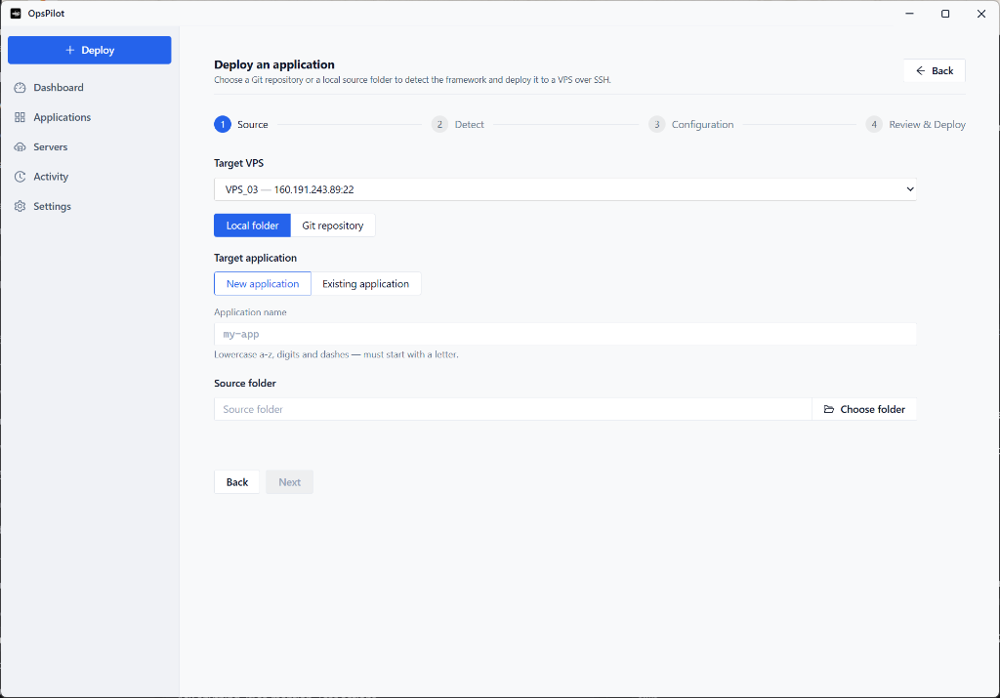
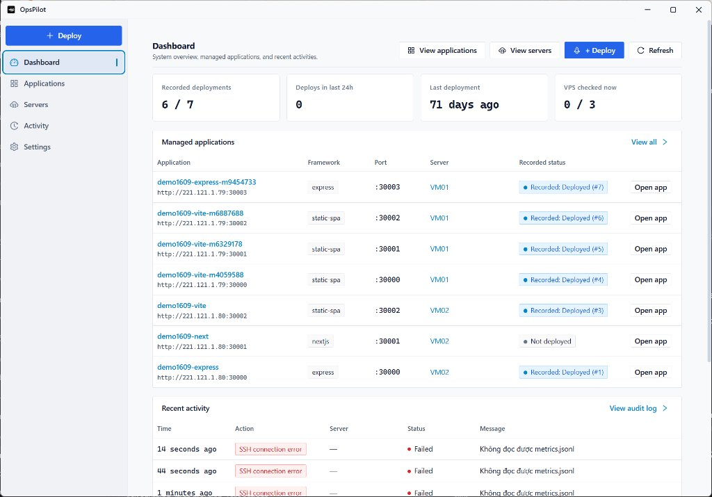
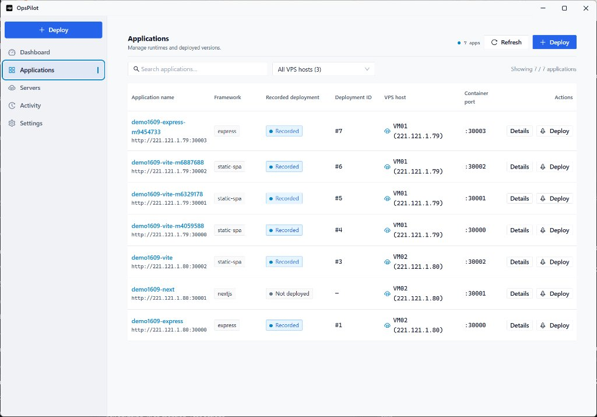
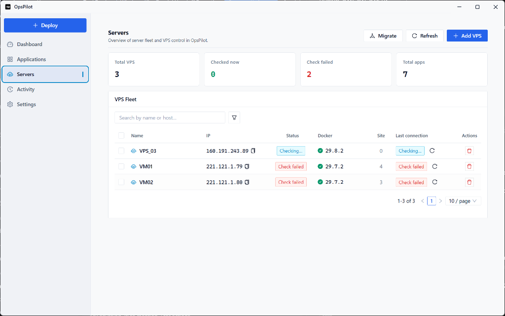
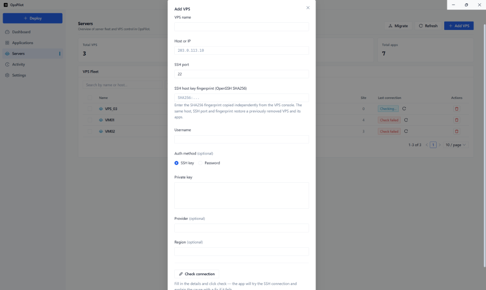
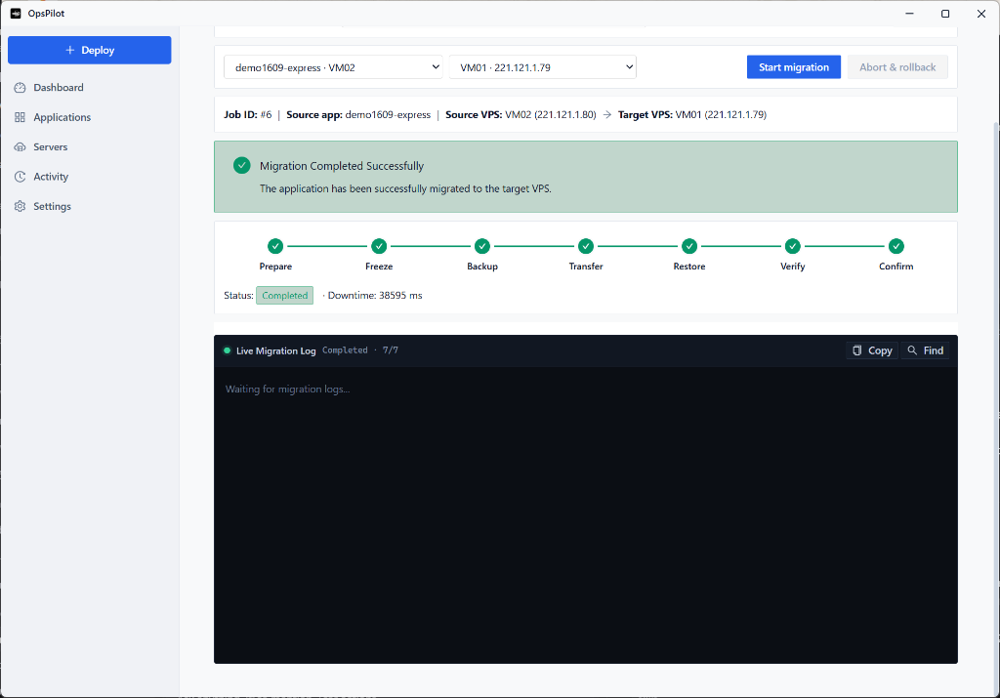
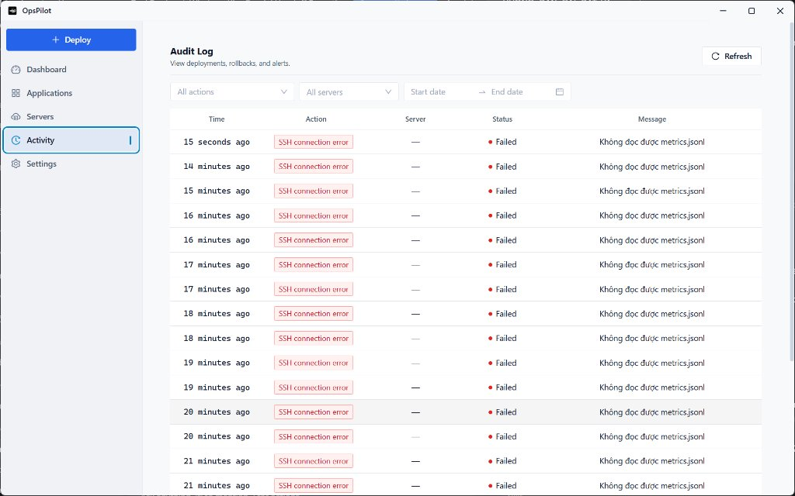
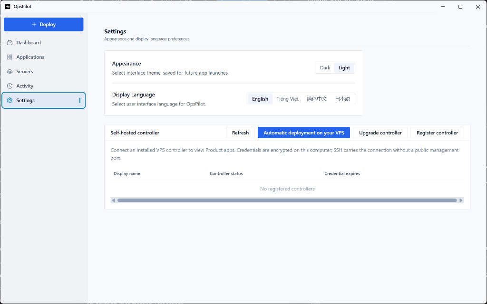

# Hướng dẫn Cài đặt & Sử dụng OpsPilot (Windows)

Chào mừng bạn đến với **OpsPilot** — ứng dụng giúp bạn quản lý máy chủ (VPS) và triển khai các dự án/ứng dụng web lên máy chủ chỉ với vài thao tác trực quan, không cần phải gõ nhiều câu lệnh phức tạp.

Tài liệu này hướng dẫn bạn từng bước từ lúc tải file về máy cho đến khi cài đặt xong và sử dụng thành thạo các tính năng bên trong ứng dụng.

---

## Phần 1: Cài đặt ứng dụng lên máy tính

Bạn chỉ cần file **`OpsPilot-0.2.0-setup.exe`** là đã có đủ mọi thứ cần thiết (không cần cài thêm Python, Node.js hay phần mềm hỗ trợ nào khác).

### Bước 1: Mở file cài đặt
- Mở thư mục nơi bạn vừa tải file về.
- Nhấp đúp chuột vào file **`OpsPilot-0.2.0-setup.exe`** để bắt đầu cài đặt.

### Bước 2: Cấp quyền chạy cho file cài đặt (nếu Windows hỏi)
- Nếu Windows hiện bảng thông báo màu xanh *"Windows protected your PC"*:
  1. Bạn bấm vào dòng chữ **`More info`** (Thông tin thêm).
  2. Sau đó bấm nút **`Run anyway`** (Vẫn chạy) để cho phép bộ cài khởi chạy.
- *(Thông báo này xuất hiện do bộ cài chưa gắn chữ ký số thương mại của Microsoft, hoàn toàn bình thường với bản cài nội bộ).*

### Bước 3: Chờ cài đặt hoàn tất và mở ứng dụng
- Bộ cài sẽ tự động giải nén và thiết lập môi trường chạy khoảng 20–45 giây.
- Khi xong, ứng dụng **OpsPilot** sẽ tự động mở lên (và tạo sẵn biểu tượng ngoài màn hình Desktop / trong Start Menu để bạn mở lại ở những lần sau).

---

## Phần 2: Thiết lập ở lần đầu mở ứng dụng

### Bước 1: Cho phép ứng dụng khởi tạo môi trường
- Ở lần đầu tiên mở lên, ứng dụng sẽ mất vài giây để chuẩn bị môi trường làm việc và khởi động hệ thống phân tích thông minh đi kèm.
- Nếu Windows Defender Firewall có hiện hộp thoại hỏi quyền truy cập mạng nội bộ cho ứng dụng, bạn hãy chọn **`Allow access`** (Cho phép) để các tính năng theo dõi hoạt động ổn định.

### Bước 2: Chọn ngôn ngữ và giao diện quen thuộc
- Nhìn sang thanh menu bên trái, bấm vào mục **`Settings`** (Cài đặt).
- Tại đây bạn có thể chọn:
  - **Ngôn ngữ**: Tiếng Việt hoặc Tiếng Anh.
  - **Giao diện**: Sáng (Light) hoặc Tối (Dark).

### Bước 3: Thêm máy chủ VPS đầu tiên của bạn
Để bắt đầu đưa ứng dụng lên mạng, bạn cần kết nối OpsPilot với máy chủ VPS của mình:
1. Bấm vào mục **`VPS`** ở thanh menu bên trái.
2. Chọn nút thêm máy chủ mới (**Add VPS**).
3. Nhập các thông tin đăng nhập máy chủ của bạn gồm:
   - **Địa chỉ IP / Host** của VPS.
   - **Cổng SSH** (thường mặc định là `22`).
   - **Tên đăng nhập** (ví dụ `root`).
   - **Mật khẩu** hoặc chọn file **SSH Key** của bạn.
4. Bấm kiểm tra kết nối (**Test Connection**) và **Lưu**. Khi thấy báo kết nối thành công là máy chủ đã sẵn sàng!

---

## Phần 3: Các chức năng chính trong ứng dụng và cách dùng

Thanh điều hướng bên trái (Sidebar) của OpsPilot gồm nút hành động nhanh **`+ Deploy`** ở trên cùng và 5 mục quản trị chính theo đúng thứ tự: **Dashboard**, **Applications**, **Servers**, **Activity** và **Settings**. 

Dưới đây là tóm tắt nhanh và các bước thao tác cụ thể cho từng màn hình:

---

### 1. `Deploy` — Triển khai ứng dụng mới lên máy chủ (Nút `+ Deploy`)
Đóng gói và đưa ứng dụng lên máy chủ một cách tự động qua SSH qua quy trình 4 bước trực quan, không cần gõ lệnh thủ công.



- **Quy trình 4 bước:** **1 Source** (Chọn nguồn) → **2 Detect** (Nhận diện công nghệ) → **3 Configuration** (Cấu hình) → **4 Review & Deploy** (Kiểm tra và Chạy).
- **Chọn máy chủ đích (Target VPS):** Chọn máy chủ bạn muốn cài đặt ứng dụng từ danh sách thả xuống.
- **Chọn nguồn mã nguồn:** Chọn **`Local folder`** (nếu mã nguồn nằm trên máy tính của bạn) hoặc **`Git repository`** (nếu mã nguồn nằm trên GitHub/GitLab).
- **Mục tiêu ứng dụng (Target application):** Chọn **`New application`** để tạo ứng dụng mới hoặc **`Existing application`** để cập nhật phiên bản cho ứng dụng đã có.
- **Thư mục nguồn (Source folder):** Bấm nút **`Choose folder`** để chọn nhanh thư mục dự án trên máy tính của bạn, sau đó bấm **`Next`** để ứng dụng tự động phân tích và hoàn tất các bước tiếp theo.

---

### 2. `Dashboard` — Màn hình tổng quan hệ thống
Cung cấp bức tranh toàn cảnh về số lượng máy chủ kết nối, các ứng dụng đang chạy và các hoạt động gần nhất trong hệ thống.



- **Các nút điều hướng nhanh ở góc trên:** Bấm **`View applications`** để sang danh sách ứng dụng, **`View servers`** để sang danh sách máy chủ, hoặc bấm nút xanh **`+ Deploy`** để triển khai ngay.
- **4 thẻ chỉ số nhanh:** Theo dõi tức thì số lượng bản ghi triển khai (**Recorded deployments**), số lượt triển khai trong 24 giờ qua (**Deploys in last 24h**), lần triển khai gần nhất (**Last deployment**) và trạng thái kết nối máy chủ (**VPS checked now**).
- **Bảng ứng dụng đang quản lý (Managed applications):** Xem danh sách ứng dụng, framework (Express, Static-SPA, Next.js...), cổng mạng (Port), máy chủ đang chạy và bấm nút **`Open app`** để mở trực tiếp ứng dụng trên trình duyệt web.
- **Bảng hoạt động gần đây (Recent activity):** Theo dõi nhật ký các sự kiện vừa diễn ra hoặc bấm **`View audit log >`** để xem toàn bộ lịch sử chi tiết.

---

### 3. `Applications` — Quản lý các ứng dụng đang chạy
Giám sát tập trung, kiểm tra cổng mạng và điều khiển các ứng dụng web đã được đưa lên máy chủ.



- **Tìm kiếm và lọc ứng dụng:** Sử dụng ô **`Search applications...`** hoặc mở bộ lọc **`All VPS hosts`** để lọc ứng dụng theo từng máy chủ cụ thể.
- **Theo dõi thông tin chi tiết:** Bảng hiển thị đầy đủ tên ứng dụng (**Application name**), công nghệ (**Framework**), trạng thái ghi nhận (**Recorded deployment**), mã phiên (**Deployment ID**), máy chủ lưu trữ (**VPS host**) và cổng mạng nội bộ (**Container port**, ví dụ `:30000`, `:30001`).
- **Thao tác nhanh (Actions):** 
  - Bấm nút **`Details`** để xem thông số chi tiết của ứng dụng.
  - Bấm nút **`Deploy`** để cập nhật hoặc triển khai lại phiên bản mới cho ứng dụng đó.

---

### 4. `Servers` — Quản lý máy chủ VPS & Thêm máy chủ mới
Quản lý tập trung toàn bộ danh sách máy chủ VPS, kiểm tra kết nối SSH và theo dõi trạng thái Docker của từng máy.



- **4 thẻ trạng thái phía trên:** Xem tổng số máy chủ (**Total VPS**), số máy đang kiểm tra (**Checked now**), số máy gặp sự cố kết nối (**Check failed**) và tổng số ứng dụng đang chạy trên toàn bộ hệ thống (**Total apps**).
- **Danh sách máy chủ (VPS Fleet):** Xem danh sách tên máy chủ (**Name**), địa chỉ **IP** (có sẵn nút bấm để sao chép nhanh IP), trạng thái (**Status**), phiên bản **Docker** đang chạy (ví dụ `29.8.2`), và thời điểm kết nối gần nhất (**Last connection**).
- **Kiểm tra kết nối lại:** Bấm biểu tượng xoay vòng ở cột *Last connection* để kiểm tra lại tín hiệu kết nối đến VPS đó.
- **Xóa máy chủ:** Bấm biểu tượng thùng rác màu đỏ ở cột *Actions* để gỡ máy chủ khỏi danh sách khi không còn sử dụng.
- **Thêm máy chủ mới:** Bấm nút màu xanh **`+ Add VPS`** ở góc trên bên phải để mở cửa sổ thêm máy chủ:



  1. Nhập tên gợi nhớ (**VPS name**), địa chỉ IP (**Host or IP**) và cổng SSH (**SSH port**, mặc định `22`).
  2. Nhập tên tài khoản (**Username**, ví dụ `root`).
  3. Chọn phương thức xác thực (**Auth method**): chọn **`SSH key`** (dán nội dung khóa riêng Private key) hoặc chọn **`Password`** (nhập mật khẩu VPS).
  4. Bấm nút **`Check connection`** ở dưới cùng để kiểm tra kết nối thông suốt trước khi lưu lại.

---

### 5. `Migrate` — Chuyển đổi ứng dụng giữa các máy chủ VPS
Hỗ trợ di chuyển toàn bộ ứng dụng từ máy chủ này sang máy chủ khác với quy trình sao lưu và phục hồi an toàn, tự động tính toán thời gian gián đoạn (downtime).



- **Cách mở tính năng:** Bấm vào nút **`Migrate`** ở góc trên bên phải của trang **Servers**.
- **Chọn nguồn và đích:**
  - Chọn ứng dụng và VPS nguồn cần di chuyển (**Source app / Source VPS**).
  - Chọn VPS đích muốn chuyển tới (**Target VPS**).
- **Bắt đầu di chuyển:** Bấm nút màu xanh **`Start migration`** (hoặc nút **`Abort & rollback`** nếu cần dừng lại và khôi phục về trạng thái cũ).
- **Theo dõi tiến trình 7 bước tự động:** Hệ thống tự động thực hiện tuần tự: **Prepare** (Chuẩn bị) → **Freeze** (Đóng băng tạm thời) → **Backup** (Sao lưu dữ liệu) → **Transfer** (Truyền tải qua VPS mới) → **Restore** (Phục hồi dữ liệu) → **Verify** (Xác minh) → **Confirm** (Hoàn tất).
- **Khung nhật ký trực tiếp (Live Migration Log):** Hiển thị chi tiết từng dòng lệnh đang chạy và tổng thời gian chuyển giao thành công.

---

### 6. `Activity` — Tra cứu nhật ký & Lịch sử hoạt động (Audit Log)
Lưu trữ đầy đủ lịch sử của mọi lần triển khai, cảnh báo và lỗi kết nối, giúp bạn dễ dàng theo dõi và đối soát khi có sự cố.



- **Bộ lọc thông minh:** 
  - Lọc theo loại hành động (**All actions**).
  - Lọc theo máy chủ (**All servers**).
  - Lọc theo khoảng thời gian (**Start date → End date**).
- **Bảng nhật ký hoạt động:** Xem rõ thời điểm diễn ra (**Time**), loại hành động (**Action**), máy chủ liên quan (**Server**), trạng thái (**Status**, ví dụ: `Failed` màu đỏ hoặc `Success` màu xanh) và thông điệp chi tiết (**Message**) để biết chính xác lý do nếu có lỗi phát sinh.
- **Nút Refresh:** Bấm nút **`Refresh`** ở góc trên bên phải để tải lại các bản ghi mới nhất.

---

### 7. `Settings` — Tùy chỉnh giao diện & Ngôn ngữ hiển thị
Cung cấp các tùy chọn thiết lập cá nhân giúp bạn sử dụng ứng dụng thuận tiện và quen thuộc nhất.



- **Giao diện (Appearance):** Bấm chọn giữa **`Dark`** (chế độ nền tối) hoặc **`Light`** (chế độ nền sáng) tùy theo sở thích làm việc của bạn.
- **Ngôn ngữ hiển thị (Display Language):** Bấm chọn chuyển đổi nhanh giữa các ngôn ngữ: **`English`**, **`Tiếng Việt`**, **`简体中文`** hoặc **`日本語`**. Ứng dụng sẽ tự động chuyển đổi ngôn ngữ ngay lập tức mà không cần khởi động lại.
- **Bộ điều khiển máy chủ (Self-hosted controller):** Khu vực quản lý kết nối an toàn với controller trên VPS dành cho người dùng nâng cao khi cần nâng cấp hoặc đăng ký mới bộ điều khiển.

---

## Phần 4: Lưu ý khi Cập nhật hoặc Gỡ cài đặt phần mềm

Để đảm bảo an toàn cho toàn bộ cài đặt và không bị lỗi khóa file:

- **Khi muốn cập nhật lên phiên bản mới:**
  1. Hãy **đóng hoàn toàn ứng dụng OpsPilot** đang mở trước (bấm nút `X` hoặc chọn Exit để tắt hẳn app).
  2. Sau đó mới chạy file cài đặt phiên bản mới (`OpsPilot-...-setup.exe`). Danh sách VPS và lịch sử của bạn vẫn sẽ được giữ nguyên.

- **Khi muốn gỡ cài đặt ứng dụng khỏi máy:**
  1. **Đóng hoàn toàn ứng dụng OpsPilot** đang chạy.
  2. Trên Windows, vào **Settings (Cài đặt)** → **Apps (Ứng dụng)** → **Installed apps (Ứng dụng đã cài đặt)**.
  3. Tìm **OpsPilot**, bấm vào dấu ba chấm (`...`) bên cạnh và chọn **Uninstall (Gỡ cài đặt)**.

---

## Phần 5: Mẹo xử lý nhanh nếu gặp trục trặc

- **Bộ cài báo lỗi không thể ghi đè hoặc báo app đang chạy:** Bạn mở Task Manager (`Ctrl + Shift + Esc`), tìm nếu còn tiến trình **OpsPilot** nào đang chạy ngầm thì bấm **End task**, sau đó chạy lại bộ cài.
- **Mở ứng dụng lên thấy màn hình trắng:** Do một số máy tính có driver đồ họa chưa tương thích, bạn có thể nhấn phím `Windows + R`, dán dòng lệnh dưới đây rồi bấm `Enter` để mở lại bình thường:
  ```text
  "%LocalAppData%\Programs\OpsPilot\OpsPilot.exe" --disable-gpu
  ```
