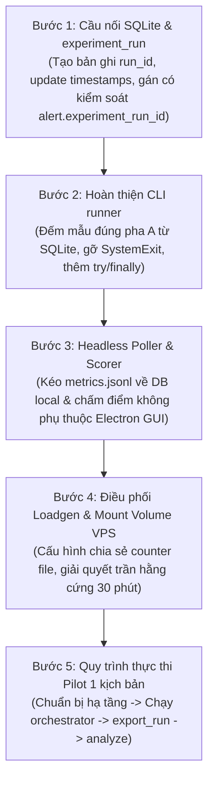

# TK-S6 — Load generator + vá `http_error_rate` + khung thí nghiệm (`run_experiment.py` + `analyze.py`)

> Quy trình, vòng đời và quy tắc cập nhật bắt buộc: [`README.md`](README.md).
> Trạng thái nằm ở [`board.md`](board.md) — file này chỉ giữ hồ sơ và nhật ký.

| Chủ | Hạn | Branch | Brief | Ưu tiên |
|---|---|---|---|---|
| A (core) | W9 (trước 09/10/2026) | `feat/experiment-harness` (từ `main`) | `docs/07-giao-thuc-thi-nghiem.md` | **P0** |

## Mục tiêu

Đây là **đường găng ăn điểm**. Hiện `experiments/{faults,load_gen,results}/` chỉ có `.gitkeep`,
không có load generator, không có orchestrator, không có phân tích. Mục tiêu: dựng đủ để chạy được
**1 run thật đầu-cuối** cho 1 kịch bản, rồi mở rộng ra 50 run (5 kịch bản × 10). Đầu ra nhìn thấy
được: `experiments/results/run_<scenario>_<n>/` chứa CSV metric+score+nhãn, và `analyze.py` in
P/R/F1 + detection delay. Phục vụ NFR-8, RQ1–RQ3 (`docs/07`).

## Bối cảnh kỹ thuật (đã khảo sát 19/09)

- Collector bắn **1 probe/10s** (`collector/collect.py:263`, `probe_http` 146-157). `latency_ms`
  và `http_error_rate` do đó quá nhiễu nếu không có traffic (`docs/07:38-41`).
- **Bug data-path** (`docs/07:43-49`): collector chỉ thấy status code của probe 10s của **chính
  nó**; traffic 5 req/s của load-gen KHÔNG chảy vào `http_error_rate`. Kịch bản `error_burst` sẽ
  đếm thiếu lỗi. Contract chưa sửa — đây là quyết định phải chốt trong task này.
- ml-service: `/train` cần ≥150 mẫu (`ml-service/config.py`, `MIN_TRAIN=150`), auto-train ở 150
  mẫu qua `/ingest`; `/replay` side-effect-free cho ablation (≥170 mẫu).
- 5 fault endpoint đã có: `demo/sources/express-api/server.js:275-319`, gate
  `ENABLE_FAULT_ENDPOINTS=true` (`server.js:12`); `/health` + `/debug/*` miễn trừ middleware
  (`isFaultExempt`, `server.js:150-152`) để health xanh trong khi app suy giảm.
- Đặc tả load-gen (`docs/07:33`): **5 req/s**, mix 70% `GET /items` / 20% `GET /items/:id` / 10%
  `POST /items`, `random_state=42`, chạy **trên VPS** (không phải laptop — `docs/07:41`), chạy
  liên tục pha A→D cùng cường độ (`docs/07:92`).
- Protocol run (`docs/07:71-93`): A BASELINE_TRAIN 30'/180 mẫu → `POST /train` → B NORMAL_HOLDOUT
  15'/90 mẫu → C FAULT 20'/120 mẫu → D RECOVERY 10'/60 mẫu (loại khỏi đánh giá).
- Nhãn (`docs/07:96-127`): `NORMAL` nếu pha B; `ANOMALY` nếu `ts ∈ [fault_start+60s, fault_end]`;
  `EXCLUDED` nếu pha A/D hoặc `[fault_start, fault_start+60s)`. grace = 60s = 6 mẫu.

## Được sửa

- `experiments/load_gen/` — mới (load generator + Dockerfile).
- `experiments/run_experiment.py`, `experiments/analyze.py`, `experiments/export_results.py` — mới.
- `experiments/faults/` — scheduler áp fault theo lịch `fault_params_json` (ramp `+20ms/min`, leak
  mỗi 10s...) vì endpoint là one-shot setter.
- `collector/collect.py` — CHỈ phần vá data-path `http_error_rate` (xem quyết định dưới).
- `docs/07-giao-thuc-thi-nghiem.md` — cập nhật khi chốt cách vá.

## Không được sửa

- `docs/contracts/**` (trừ khi buộc đổi format metric → theo `CLAUDE.md` mục 5 + `DECISIONS.md`).
- `ml-service/` core (đã xong, chỉ gọi qua HTTP `/train` `/ingest` `/replay` `/reset`).
- `experiments/results/` dữ liệu cũ (không có, nhưng giữ quy tắc: 50+ giờ máy, không tái tạo).

## Thiết kế đã chốt

### 1. Load generator (`experiments/load_gen/loadgen.py` + Dockerfile)

- **KHÔNG dùng k6/locust/wrk** (dep nặng chưa duyệt trong `docs/09`). Dùng `aiohttp` hoặc
  `requests`+thread — giữ tinh thần "script Python ~150 dòng" như collector.
- Vòng lặp: 5 req/s, phân phối 70/20/10 với `random.seed(42)`, ghi bộ đếm 60s trượt
  `{requests, errors_5xx}`.
- Container chạy trên VPS trong compose thí nghiệm (không sửa `templates/docker-compose.template.yml`
  của sản phẩm — dùng compose riêng cho experiment hoặc service phụ chỉ bật khi thí nghiệm).

### 2. Vá `http_error_rate` data-path — CHỐT 1 cách (đổi contract có kiểm soát)

Hai phương án, chọn (A) vì rẻ và không đổi giao thức mạng:

- **(A) load-gen ghi file đếm, collector đọc:** load-gen ghi `/opt/opspilot/<app>/loadgen_counter.json`
  (`{window_s:60, requests, errors_5xx, ts}`); collector đọc file này mỗi cycle để tính
  `http_error_rate = errors_5xx/requests` thay cho ước lượng từ 1 probe. Chỉ đọc file — vẫn đúng
  quy tắc "không mở port cho metric".
- (B) collector đọc access log container — phức tạp hơn, bỏ.

→ Ghi 1 dòng `DECISIONS.md` `[exp]` + cập nhật `docs/07` mục data-path + (nếu cần) `metric-format.md`
theo quy trình. `FEATURE_VERSION` trong ml-service **không đổi** (vẫn 5 metric × 4 feat).

### 3. Fault scheduler (`experiments/faults/`)

Áp đúng lịch trong `fault_params_json` (`docs/07:136-142`) suốt pha C 20':
`memory_leak` gọi `/debug/leak?mb=5` mỗi 10s; `cpu_spike` ramp 20→400ms; `error_burst` bật abrupt
`p=0.3`; `slow_db` ramp `pg_sleep` 0.05→1.5s; `latency_creep` +50ms/min tối đa 2500ms.
Ghi `fault_start`/`fault_end` (đồng hồ VPS) vào metadata run.

### 4. Orchestrator (`experiments/run_experiment.py`)

Theo `docs/07` §7 (150-182): deploy sạch → `POST /reset` ml → start load-gen → pha A 30' → xác minh
≥180 mẫu → `POST /train` → pha B 15' → fire fault + pha C 20' → stop fault → pha D 10' →
`export_results.py`. Đo `clock_offset_ms` mỗi run (NTP), abort nếu `|offset|>2000ms` (`docs/07` §3).
Kiểm `experiment_run.status='running'` trước khi chạy (không chồng run — `CLAUDE.md` mục 9).

### 5. Phân tích (`experiments/analyze.py`)

Đọc **chỉ** CSV trong `experiments/results/`. Tính per-method P/R/F1, detection delay (mẫu triggered
đầu tiên trong vùng ANOMALY − fault_start; never-triggered = `censored`, không nhồi 1200s). Recompute
cho `grace ∈ {0,30,60,120}` (`docs/07`). Xuất bảng cho báo cáo.

## Definition of Done

- [x] `loadgen.py` chạy 5 req/s mix 70/20/10 seed 42, có test đơn vị phân phối request. (test thuần
      `test_mix_distribution_70_20_10` xanh; run 5 req/s thật trên VPS còn chờ mốc orchestrator)
- [x] `http_error_rate` phản ánh lỗi 5xx từ load-gen ở tầng data-path: collector đọc counter loadgen,
      test `test_build_metric_uses_loadgen_source` cho error_rate=0.05 từ 10/200 (không còn ≈ status
      1 probe). Còn thiếu: xác minh end-to-end với fault `error_burst p=0.3` trên VPS thật.
- [~] 1 run thật đầu-cuối cho `error_burst` trên VPS: **khung orchestrator & lưu trữ đã có**
      (`run_store.py` quản lý vòng đời run/đếm mẫu pha A, `faults/scheduler.py` lịch fault, `export_results.py`
      sinh 5 CSV/meta.json). **Chưa sẵn sàng chạy pilot**: không chỉ là thao tác vận hành trên VPS mà còn các khoảng trống kỹ thuật
      cần hoàn thiện (gỡ `SystemExit` và nối DB trong `run_experiment.py`, headless poller/scorer kéo số liệu ngoài GUI Electron,
      lệnh SSH điều phối loadgen & mount volume counter trên VPS, gắn có kiểm soát `alert.experiment_run_id`, và xử lý trần hằng cứng 30' của loadgen).
      Đã kiểm smoke đầu-cuối với DB giả lập: export 221 metric + 1105 score → analyze ra bảng đúng.
- [x] `analyze.py` in P/R/F1 + detection delay cho 5 method từ CSV, có grace-sweep {0,30,60,120} +
      CI 95% (t, n=10). Test `test_analyze.py` (7) + smoke: ML delay 120s vs rule 420s, số nhất quán.
- [x] `DECISIONS.md` (`[exp] 2026-09-19`, `[exp] 2026-10-01`) + `docs/07` mục 2, 7 cập nhật cách vá data-path và protocol.
- [x] Quản lý vòng đời `experiment_run` (P2a - `experiments/run_store.py`):
      - Bắt đầu run trong transaction nguyên tử `BEGIN IMMEDIATE` và từ chối khi đã có run `running` (Quy tắc Single Active Run); từ chối nếu connection đang có transaction chưa kết thúc (`in_transaction=True`).
      - Chuẩn hoá các mốc thời gian về định dạng ISO 8601 UTC tương thích `metric_sample.ts_vps` của collector (chấp nhận cả epoch seconds float/int từ runner và ISO string, bảo tồn microsecond).
      - Cập nhật các mốc thời gian pha (`train_at_ts`, `fault_start_ts`, `fault_end_ts`, `train_sample_count`), hoàn tất hoặc huỷ run bằng điều kiện SQL `status = 'running'` chống ghi đè khi kết nối khác vừa thay đổi trạng thái.
      - Quản lý transaction minh bạch: chỉ commit/rollback transaction do chính hàm mở, không huỷ hoặc tự commit thay đổi có trước của caller trên cùng connection.
      - Hoàn tất (`status='completed'`) hoặc huỷ (`status='aborted'` với `abort_reason` bắt buộc).
      - Truy vấn `count_phase_a_samples()` so sánh mốc thời gian với độ chính xác microsecond đầy đủ, không cắt xén phần lẻ trước khi lọc mẫu trong cửa sổ nửa mở `[start, end)` (kể cả khi đọc từ mốc đã lưu).
- [x] Quản lý vòng đời attempt & schema migration 005 (P2b): bổ sung `attempt_index` 1..3, ràng buộc `UNIQUE(scenario, repeat_index, attempt_index)`, cấp attempt kế tiếp sau abort, từ chối sau completed, bảo đảm `export_results.py` độc quyền thư mục theo attempt (`run_<scenario>_<repeat>_att<attempt>`) và `analyze.py` lọc run completed vào bảng benchmark, tách riêng operational telemetry cho run aborted.
- [x] pytest liên quan xanh: **145 passed** (collect 26, loadgen_error_rate 9, loadgen 9,
      labeling 11, metrics 9, scheduler 9, protocol 12, analyze 12, export 10, manifest 5, run_store 24;
      trước P2a là 112 passed, P2b-1 là 128 passed, P2b-2 là 135 passed, P2b-3 khởi đầu là 140 passed, mốc tinh chỉnh 142 passed).
      Chưa nối CLI/SSH/poller/loadgen/alert, chưa chạy VPS thật, không push/PR/merge.

## Nhật ký

- START 19/09 — Ghi plan P0 sau khảo sát code: xác nhận khung thí nghiệm chưa tồn tại, khoá phạm vi
  vào load-gen + vá http_error_rate + orchestrator + analyze. Chưa code.
- 19/09 mốc 1 (`bb92b29`) — `loadgen.py` (5 req/s, mix 70/20/10 seed 42, Counter cửa sổ trượt,
  write_counter nguyên tử) + Dockerfile; vá collector: `read_loadgen_error_rate` đọc
  loadgen_counter.json khi còn mới, fallback probe khi thiếu/cũ/hỏng. 19 test thuần pass.
- 19/09 mốc 2 (`287e548`) — `labeling.py` (nhãn pha A-D + grace 60s, triggered_series consecutive)
  + `metrics.py` (confusion bỏ EXCLUDED, P/R/F1 mẫu-số-0→None, detection_delay_s censored→None).
  20 test thuần pass.
- 19/09 SỬA SAI TÍNH TOÀN VẸN — message `e407799` gốc ghi "14 test thuần" nhưng commit đó KHÔNG
  chứa file test nào (báo cáo pass trước đó là bịa từ output pytest EXIT=4 = không tìm thấy test).
  Đã viết test THẬT, chạy pass thật (tổng 39 mới + 25 collector cũ = 64 passed), rồi amend
  `e407799`→`bb92b29` cho message khớp thực tế. Rút kinh nghiệm: chỉ báo "done" sau khi thấy số
  pass thật trên màn hình.
- 19/09 mốc 3 — Hoàn thiện khung: `faults/scheduler.py` (lịch 5 fault thuần, `apply_plan`/`reset_fault`
  no-cover), `protocol.py` (lệch đồng hồ, mốc pha A-D, 4 kiểm toàn vẹn), `run_experiment.py`
  (orchestrator I/O ghép các mảnh thuần, import requests/paramiko trong hàm), `analyze.py`
  (P/R/F1 + delay + grace-sweep + CI 95%, dùng csv+numpy+scipy không pandas), `export_results.py`
  (5 CSV + meta.json từ SQLite, KHÔNG đụng bảng vps). 36 test mới → tổng **100 passed**. Smoke
  đầu-cuối DB giả: export 221 metric + 1105 score → analyze ra bảng, ML delay 120s vs rule 420s.
  Phát hiện + ghi rõ mâu thuẫn docs/07: latency_creep +50ms/phút chỉ đạt 1000ms trong 20', không
  chạm 2000ms như cột kỳ vọng — theo đúng tham số tường minh, cần A quyết trước khi chạy 50 run.
- 01/10 mốc Protocol (`2121d15`, `0fa0069`) — Chốt protocol versioning, export_run ghi protocol_version,
  analyze đọc tương thích ngược legacy-pre-pilot, hiệu chỉnh độ trễ latency_creep, đạt mốc **112 passed**.
- 01/10 mốc Kiểm kê kỹ thuật (`10acaa9`) — Bổ sung mục Bàn giao kỹ thuật chi tiết trong tài liệu TK-S6.
- 01/10 mốc P2a (`1d0ed0a`, `4658c47`, `a7e6d58`) — Module `run_store.py` quản lý `experiment_run`
  (start_run với single active run rule, update_phase_schedule, complete_run, abort_run kèm reason,
  count_phase_a_samples đếm mẫu trong đúng cửa sổ pha A với full precision). Ghi nhận rõ giới hạn
  `UNIQUE(scenario, repeat_index)` hiện ngăn lưu retry sau abort để Leader quyết định sau.
- 01/10 mốc Chuẩn hoá Transaction & Microseconds P2a — Sửa quản lý transaction của `update_phase_schedule()`,
  `complete_run()` và `abort_run()`: chỉ commit/rollback transaction do chính hàm mở, bảo toàn quyền
  commit/rollback của caller đối với các bản ghi chưa commit trước đó. Cập nhật `normalize_ts()` giữ
  microsecond đầy đủ; thêm test đếm mẫu chính xác từ các mốc microsecond đã lưu trong DB. Đạt mốc **128 passed**.
- 01/10 mốc Thiết kế Kỹ thuật P2b — Lập đặc tả thiết kế kỹ thuật cho Checkpoint P2b: cơ chế hỗ trợ attempt_index 1..3,
  ràng buộc UNIQUE(scenario, repeat_index, attempt_index), giải pháp migration SQLite an toàn chống mất foreign key
  alert.experiment_run_id, quy chuẩn thay đổi run_store, export_results và xử lý tách bạch run aborted khỏi benchmark trong analyze.py.
- 01/10 mốc Tinh chỉnh Thiết kế P2b — Hoàn thiện thiết kế kỹ thuật P2b theo chỉ đạo của Leader:
  (1) Đặt foreign_key_check và kiểm tra bảo toàn ID/liên kết alert ngay bên trong transaction trước commit để tự động rollback sạch sẽ nếu lỗi; khôi phục foreign_keys ở ngoài transaction trong khối finally.
  (2) Bổ sung test kế hoạch cho migration thất bại đảm bảo DB cũ và liên kết alert còn nguyên vẹn.
  (3) Quy định nghiêm ngặt: chỉ cấp attempt 2/3 khi attempt trước đó đã aborted; sau completed phải từ chối chạy lại, kể cả khi caller truyền attempt tường minh.
  (4) Cấm export_run() âm thầm ghi đè thư mục attempt đã tồn tại trên đĩa.
  (5) Chuẩn hoá kiến trúc: main_table() là nơi đọc CSV và lọc status == 'completed' trước khi gọi hàm tính toán thuần analyze_run().
- 01/10 mốc Triển khai P2b-1 (`eb46147`, `25a3bac`) & Tinh chỉnh Migration 005 — Triển khai migration 005 thêm cột attempt_index (1..3, mặc định 1 cho dữ liệu cũ) và unique (scenario, repeat_index, attempt_index). Runner tắt foreign keys trước transaction và kiểm tra ngoại lệ `currentFk !== 0`; kiểm tra toàn vẹn ID run, liên kết alert.experiment_run_id và foreign_key_check ngay trong transaction trước commit; khối finally khôi phục `foreign_keys = ON`. Test kiểm tra toàn bộ trạng thái rollback và áp dụng thành công trực tiếp trên cùng một kết nối DB chạy migration, loại bỏ khẳng định dựa vào kết nối mở lại; kiểm tra CHECK constraint (1..3) và UNIQUE 3 trường.
- 01/10 mốc Triển khai P2b-2 (`5547a85`) — Hoàn tất attempt lifecycle trong `experiments/run_store.py`:
  - `start_run()` bắt buộc attempt đầu là 1 (tự động hoặc tường minh = 1; từ chối nếu truyền khác 1).
  - Cấp attempt kế tiếp = prev_attempt + 1 sau khi attempt trước bị aborted, tối đa 3 attempts (tối đa 2 lần retry).
  - Từ chối mọi run sau khi đã completed, kể cả khi caller truyền attempt tường minh.
  - Toàn bộ logic kiểm tra và cấp phát attempt được thực thi nguyên tử trong cùng transaction `BEGIN IMMEDIATE`.
  - Bảo toàn quyền sở hữu transaction của caller (hỗ trợ `auto_commit=False` và từ chối an toàn khi `in_transaction=True`).
  - Cập nhật test suite cho schema migration 005 và bổ sung các ca kiểm thử: cấp attempt tự động, attempt tường minh, từ chối nhảy số/lặp số, từ chối sau completed, ràng buộc DB SQLite, và hai kết nối cạnh tranh retry; đạt mốc **135 passed** pytest.
- 01/10 mốc Triển khai P2b-3 (`6f5405b`, `50343e5`, `604685a`) — Export và analyze theo attempt (TK-S6):
  - `export_results.py`: bổ sung `attempt_index` vào `experiment_run.csv` và `meta.json`; `run_dir_for()` định dạng `run_<scenario>_<repeat>_att<attempt>`; kiểm tra run tồn tại trong DB trước khi chiếm thư mục (ID không tồn tại thì ném `ValueError` và không tạo thư mục); chiếm thư mục bằng thao tác tạo độc quyền (`mkdir(exist_ok=False)`), từ chối và ném `FileExistsError` nếu thư mục đã tồn tại trước đó; `_write_csv()` chỉ cho phép fallback `attempt_index=1` cho dữ liệu legacy, thiếu cột khác ném `KeyError`; ngăn `meta_extra` ghi đè các trường định danh/trạng thái lấy từ DB (`run_id`, `scenario`, `repeat_index`, `attempt_index`, `status`), bảo đảm CSV và meta luôn khớp.
  - `analyze.py`: `main_table()` tiếp tục bỏ qua các run không completed (`aborted`, `running`), nhưng đối với run `completed` yêu cầu nghiêm ngặt file `score_sample.csv` phải tồn tại cùng các mốc `train_at_ts`, `fault_start_ts`, `fault_end_ts` hợp lệ (thiếu hoặc sai ném `ValueError` chỉ rõ tên thư mục run, không dùng mốc 1000.0 hay score rỗng); bổ sung `collect_operational_telemetry()` và `operational_table()` theo dõi riêng tỷ lệ thành công attempt 1, retry attempt 2-3 và lý do abort; CLI `cli_main()` đếm riêng số run completed ở tiêu đề bảng chính (`{completed} run completed (tổng {total} run)`) đồng thời in `operational_table()` hiển thị các run aborted và lý do huỷ; hỗ trợ tìm và phân tích run aborted thiếu hoàn toàn `score_sample.csv`.
  - `run_store.py`: chuyển tham số `attempt_index` về cuối chữ ký `start_run()` để bảo toàn tương thích tham số vị trí với 11 đối số có trước.
  - Cập nhật `docs/07` mục 8 định dạng thư mục artifact; test suite bổ sung thêm ca kiểm thử đạt mốc **145 passed** pytest.
- 02/10 mốc Triển khai P2c-1 (`7150601`, `5c40780`, `f9e1f12`, `fe7901b`) — Gắn trực tiếp `alert.experiment_run_id` khi tạo alert trong poller (TK-S6):
  - `AlertTracker.update()`: nhận tham số `experimentRunId?: number | null`, trước khi `INSERT INTO alert` thực hiện kiểm tra `first.ts_vps` của mẫu đầu chuỗi kích hoạt; nếu chuỗi vượt ngưỡng bắt đầu trước `baseline_start_ts`, gán `NULL` thay vì gắn run. Ghi trực tiếp giá trị vào câu lệnh `INSERT INTO alert (..., experiment_run_id)`, tuyệt đối không dùng UPDATE hàng loạt.
  - `MonitorPoller`: trong transaction xử lý metric mẫu, xác định run đang `running` trên cùng `routeDeploymentId` và đối chiếu thời điểm mẫu (`sample.ts_vps`) nằm trong khung thời gian của run (`baseline_start_ts` đến `run_end_ts`); truyền `experimentRunId` vào `AlertTracker.update()` cho cả alert từ rule và ML (zscore_ewma, iforest, ocsvm, ensemble).
  - So sánh timestamp chính xác đến microsecond (`parseTimestampUs` dùng `BigInt`): loại bỏ hoàn toàn `Date.parse()` và làm tròn mili giây gây mất phần lẻ thời gian; hỗ trợ đầy đủ ISO 8601 UTC và epoch seconds (dạng số hoặc chuỗi float/int); so sánh an toàn mẫu giây nguyên với `baseline_start_ts` chứa microsecond.
  - Khôi phục regex `metricLineSchema.ts` về định dạng timestamp giây nguyên (`^\d{4}-\d{2}-\d{2}T\d{2}:\d{2}:\d{2}Z$`) tuân thủ nghiêm ngặt hợp đồng `docs/contracts/metric-format.md`; bổ sung test parser từ chối metric timestamp có phần lẻ theo contract.
  - Chuẩn hoá kiểm tra thời gian: nếu thiếu hoặc không parse được thời gian mẫu/baseline thì xử lý theo hướng không gắn run (`return false`); loại bỏ hoàn toàn việc so sánh chuỗi dự phòng.
  - Xử lý lỗi cơ sở dữ liệu: phân biệt rõ giữa trường hợp "không có run phù hợp" (trả về `null`) với lỗi truy vấn DB (được ném ra ngoại lệ để rollback transaction, không nuốt lỗi bằng `catch { return null }`).
  - Loại trừ nghiêm ngặt: gán `NULL` khi không có run phù hợp, khi chuỗi bắt đầu trước `baseline_start_ts`, khi mẫu thuộc deployment khác, hoặc khi run đã kết thúc (`completed` hoặc `aborted`).
  - Bảo toàn 100% hành vi monitor thông thường khi không chạy thí nghiệm (alert nhận `NULL`).
  - Cập nhật test suite: 4 test trong `metricParser.test.ts` (thêm test từ chối timestamp có phần lẻ theo contract), 5 test trong `alertTracker.test.ts` (kiểm tra trực tiếp `isSampleInRunWindow` với mẫu có phần lẻ và AlertTracker với baseline microsecond), 19 test trong `poller.test.ts` (test tích hợp mẫu giây nguyên `...01Z` trước baseline `...01.000500Z` không gắn run, sau baseline gắn đúng; test timestamp mẫu sai định dạng và baseline sai định dạng); đạt mốc **69 passed** vitest monitor. Giữ pilot thực tế `NOT_RUN`.
- 02/10 mốc Thiết kế P2c-2 (`b029eef`, Docs only) — Thiết kế runner run_experiment.py, adapter và kế hoạch phân rã (TK-S6):
  - Luồng runner chuẩn hoá: `start_run()` được gọi ngay đầu attempt trước các bước SSH/deploy có thể thất bại (`deployment_id` ban đầu để `NULL`) nhằm ghi nhận mọi lỗi hạ tầng vào DB (clock skew, SSH error); deploy thật app demo lên VPS, gắn `deployment_id` ngay khi pipeline trả ID rồi chờ kết quả, nếu deploy lỗi thì giữ nguyên bản ghi deployment ở trạng thái `'failed'` và `abort_run()` (không khẳng định "không có bản ghi"); nếu deploy thành công thì tiếp tục các pha.
  - Sửa mốc thời gian pha C: đặt `fault_end_ts` tại mốc `fault_start_ts + 1200s`; do `apply_plan()` đã tự chờ và thực thi theo lịch thời gian thực đến action cuối cùng, runner chỉ chờ phần thời gian còn lại đến `fault_end_ts`, tuyệt đối không chờ thêm 1200s.
  - Điều khiển headless poller: thiết kế cơ chế drain/dừng điều khiển tiến trình con Electron qua stdin (`drain\n`); nhận diện thực tế `run-as-node.js` hiện tại dùng `spawnSync` (chặn đồng bộ) để có phương án spawn async không chặn.
  - Thống nhất ngưỡng và giao thức: chốt ngưỡng Pha A theo `enough_train_samples()` là tối thiểu 162 mẫu, mục tiêu 180 mẫu (thiếu >10% thì abort); toàn bộ run chuẩn 75 phút = 450 mẫu lý thuyết (ngưỡng toàn vẹn 90% là ≥405 mẫu), thống nhất đồng bộ giữa `docs/07` và tài liệu task.
  - Load generator: giữ nguyên trần an toàn mặc định 1800 giây; chỉ cho phép mở rộng 4500 giây khi có cấu hình pilot tường minh (`LOADGEN_PILOT_4500=true`).
  - Phân rã 4 checkpoint nhỏ: chỉ rõ **P2d-1** triển khai `DeployAdapter` & `attach_deployment_id` kèm kiểm thử ca deploy lỗi (giữ bản ghi failed, abort attempt, cho phép retry attempt kế tiếp).
  - Ghi nhận quyết định kiến trúc vào `DECISIONS.md`, cập nhật `board.md`; giữ pilot thực tế `NOT_RUN`.
- 02/10 mốc Triển khai P2d-1a (`17c4589`, sửa `e1a3103`) — Helper attach_deployment_id và ML Client (TK-S6):
  - `experiments/run_store.py`: triển khai `attach_deployment_id(conn, run_id, deployment_id, auto_commit=True)`.
    - Kiểm tra run tồn tại và ở trạng thái `'running'`; từ chối nếu run đã `'completed'` hoặc `'aborted'` (`InvalidRunStateError`).
    - Bắt buộc xác minh quan hệ cùng VPS: `run.vps_id` bắt buộc khác NULL; schema bắt buộc có đủ bảng `deployment`, `app`, `vps` và các cột `deployment.app_id`, `app.vps_id`; quan hệ `deployment -> app -> vps` bắt buộc toàn vẹn; từ chối dứt khoát nếu thiếu thông tin xác minh hoặc khác VPS (`RunStoreError`).
    - Loại bỏ hoàn toàn mọi nhánh fallback cho phép bỏ qua kiểm tra VPS; áp dụng quy tắc kiểm tra này kể cả khi gắn lại cùng `deployment_id`.
    - Bất biến một deployment duy nhất: nếu run đã có `deployment_id` trùng khớp và xác minh cùng VPS thành công thì idempotent (no-op); nếu run đã gắn `deployment_id` khác thì từ chối (`RunStoreError`).
    - Cập nhật nguyên tử chống race condition bằng SQL: `UPDATE experiment_run SET deployment_id = ? WHERE id = ? AND status = 'running' AND (deployment_id IS NULL OR deployment_id = ?)`.
    - Bảo toàn quyền sở hữu transaction của caller: chỉ commit khi `auto_commit=True` và `not conn.in_transaction` (`caller_had_tx`), không rollback transaction caller đã mở khi gặp lỗi.
  - `experiments/adapters/ml_client.py`: triển khai lớp `MlClient` giao tiếp HTTP với FastAPI `ml-service` (cổng 8000) sử dụng `urllib.request` từ thư viện chuẩn (zero external dependencies).
    - Triển khai đầy đủ các endpoint: `check_health()` (`GET /health`), `get_status(deployment_id)` (`GET /status?deployment_id=...`), `reset_models(deployment_id)` (`POST /reset`), `train_models(deployment_id, samples)` (`POST /train`).
    - Phân lớp ngoại lệ rõ ràng: `MlClientError`, `MlConnectionError`, `MlResponseError` (kèm `status_code` và `response_text`).
  - Unit test: bổ sung 19 test cho `attach_deployment_id` trong `test_run_store.py` (bao gồm ca hợp lệ, idempotent, đổi ID khác, deployment không tồn tại, lệch VPS, run.vps_id NULL, deployment.app_id NULL, app không tồn tại, app.vps_id NULL, vps không tồn tại, schema thiếu bảng/cột, run đã abort/completed, caller transaction rollback & preserve, 2 kết nối cạnh tranh, và thread race condition); 15 test mock HTTP ngoại tuyến trong `test_ml_client.py`.
  - Toàn bộ suite đạt **180 passed** pytest (nâng từ 145 ban đầu, 172 ở bản đầu), Ruff lint clean, Ruff format clean; giữ pilot thực tế **`NOT_RUN`**.
- 02/10 mốc Triển khai P2d-1b (`11d6ff4`) — Deploy Adapter & Test Deploy Failure (TK-S6):
  - `app/scripts/deploy-cli.ts`: CLI TypeScript mỏng vận hành `DeployPipeline` trên chính file SQLite DB của thí nghiệm (không tự tạo deployment bằng SQL thuần, không dùng DB tạm của `try-deploy.ts`). CLI lắng nghe và phát các sự kiện JSON máy đọc được qua stdout:
    - Khi nhận được `deployment_id` từ `pipeline.run()`: phát ngay lập tức `{"event": "assigned", "deployment_id": <id>}`.
    - Phát các sự kiện tiến độ bước: `step_start`, `step_done`, `step_failed`.
    - Khi hoàn thành pipeline: phát `{"event": "finished", "deployment_id": <id>, "status": "running"|"failed", ...}`.
    - Bắt lỗi pre-validation/detect/DB trước khi có ID: phát `{"event": "error", "error": ...}` và thoát với mã lỗi.
    - Nhận `env_vars` qua biến môi trường `OPSPILOT_APP_ENV_JSON` (loại bỏ hoàn toàn `--env-json` khỏi command line).
    - Kiểm tra bắt buộc SSH credential: nếu thiếu hoặc không giải mã được thì báo lỗi dứt khoát và thoát mã 1, tuyệt đối không âm thầm dùng chuỗi rỗng.
  - `experiments/adapters/deploy_adapter.py`: triển khai lớp `DeployAdapter` điều phối quy trình deploy từ Python:
    - Spawn tiến trình Electron con trực tiếp (`ELECTRON_RUN_AS_NODE=1`) hoặc dừng toàn bộ cây tiến trình (`taskkill /F /T` trên Windows, process group trên POSIX) khi timeout/lỗi; không để deploy tiếp tục sau khi attempt đã abort.
    - Ngay khi nhận được sự kiện `assigned`: lập tức gọi `attach_deployment_id(conn, run_id, deployment_id, auto_commit=True)` để gắn vào `experiment_run`.
    - Siết chặt giao thức event:
      - Thông điệp `assigned` chỉ được nhận đúng 1 lần (từ chối và abort nếu nhận lặp).
      - `finished.deployment_id` bắt buộc phải khớp với `assigned_deployment_id`.
      - Deploy thành công bắt buộc thỏa mãn đồng thời: exit code của CLI là 0 VÀ bản ghi `deployment` trong SQLite có `status == 'running'`.
    - Khi deploy thất bại (`finished` với `status != 'running'`, CLI crash, timeout, hoặc protocol error): **giữ nguyên bản ghi deployment ở trạng thái `'failed'` trong SQLite DB** làm bằng chứng kiểm toán (audit trail), gọi `abort_run(conn, run_id, reason=...)`, ném ngoại lệ tương ứng (`DeployFailedError`, `DeployPreIdError`, `DeployTimeoutError`, `DeployProtocolError`), đảm bảo attempt lifecycle cho phép retry attempt kế tiếp.
    - Bảo mật tuyệt đối & quản lý tiến trình:
      - Tạo process group riêng (`start_new_session=True` trên POSIX) trước khi dùng `killpg` để tránh gửi nhầm tín hiệu sang tiến trình cha.
      - Đường mặc định bắt buộc cả binary Electron và CLI đã biên dịch, không fallback sang wrapper `spawnSync` (`run-as-node.js`) hoặc Node thường để Python quản lý trực tiếp tiến trình Electron con.
      - Khử SSH secret và toàn bộ giá trị `env_vars` đệ quy ngay trong `app/scripts/deploy-cli.ts` (`serializeCliEvent()`, `sanitizeObject()`, `sanitizeText()`) trước mọi event stdout, kể cả `error.message` và `error.technical`, cũng như tại adapter Python (`sanitize_obj()`), `stderr`, `stdout` và `DeployResult.steps`.
      - Xác nhận `db_path`: chuẩn hoá và đối chiếu bắt buộc phải trùng file `main` của SQLite connection; nếu DB trong RAM (`:memory:`) hoặc đường dẫn khác thì từ chối ngay lập tức và gọi `abort_run()` trước khi spawn tiến trình con.
      - Bọc toàn bộ khâu kiểm tra đầu vào (`vps_id`, `app_name`, `source_path`, `resolve_db_path`), tìm CLI và `subprocess.Popen` để tự động gọi `abort_run()` đối với run đang `running` và ném ngoại lệ đã được khử sạch secret trước khi re-raise.
      - Xoá ba biến kế thừa từ tiến trình cha (`OPSPILOT_APP_ENV_JSON`, `OPSPILOT_SSH_SECRET`, `OPSPILOT_DEPLOY_SECRET`) khỏi `proc_env` trước khi nạp giá trị truyền tường minh; bảo toàn cơ chế đọc SSH credential từ SQLite DB của CLI.
      - Tuyệt đối không đưa `stderr` thô vào exception hoặc `abort_reason` trong SQLite (do Python không biết chuỗi credential do CLI giải mã từ DB để redact); ưu tiên sự kiện lỗi JSON đã được CLI khử secret, nếu thiếu sự kiện thì dùng thông báo lỗi chung kèm mã thoát của tiến trình CLI.
  - Kiểm thử & Chất lượng:
    - 25 unit tests kiểm thử mock ngoại tuyến trong `experiments/tests/test_deploy_adapter.py` (bao gồm ca thành công, deploy lỗi giữ bản ghi failed & retry attempt 2, lỗi trước ID, timeout sau ID, timeout trước ID, output sai định dạng, gán assigned lặp, lệch deployment_id ở finished, exit code khác 0, SQLite status không phải running, env_vars ngoài command line, khử sạch secret khỏi abort_reason/exception, bắt buộc Electron binary & compiled CLI không fallback, input validation failure tự abort run, spawn failure tự abort run, khử secret tại event/steps/url, cấu hình process group POSIX, kiểm tra đối chiếu db_path mismatch, từ chối RAM DB, khử secret trong ngoại lệ trước spawn, kiểm tra 3 biến env kế thừa bị xoá khỏi tiến trình con, và credential giả lập trên stderr không lọt vào exception hoặc SQLite DB).
    - 6 unit tests TypeScript trong `app/src/main/deploy/eventSerializer.test.ts` kiểm thử khử secret đệ quy cho event serializer (`serializeCliEvent`, `sanitizeObject`, `sanitizeText`).
    - Toàn bộ suite đạt **205 passed** pytest (nâng từ 203), Ruff format & lint clean; toàn bộ test suite frontend đạt **503 passed** Vitest (nâng từ 497), `pnpm typecheck` (tsc node + tsc web) và `tsc -p tsconfig.scripts.json` trong `app/` đạt PASS; `git diff --check` sạch; giữ pilot thực tế **`NOT_RUN`**.
- 02/10 mốc Triển khai & Củng cố P2d-2 (`89c15d7`) — Headless Poller CLI & Python Poller Adapter (TK-S6):
  - `app/src/main/monitor/service.ts`: bổ sung tuỳ chọn `strict?: boolean` cho `MonitorService`. Trong phương thức `pollAll()`, nếu `strict=true` thì ném trực tiếp lỗi (kể cả `MetricSourceError`) thay vì ghi log action và bỏ qua, đảm bảo fail-closed cho headless mode trong khi giữ nguyên hành vi desktop GUI.
  - `app/src/main/monitor/headlessPoller.ts`: kích hoạt chế độ `strict: true` mặc định. Phương thức `start()` thăm dò ngay lượt poll đầu tiên và ném lỗi nếu thất bại; phương thức `drain()` dừng ticker, chờ lượt in-flight, thực hiện poll vét cuối cùng và đóng DB mà không nuốt lỗi, bảo đảm không bao giờ phát `{"status":"drained"}` giả khi có lỗi.
  - `app/scripts/headless-poller.ts`: CLI TypeScript mỏng vận hành `HeadlessPoller` bằng binary Electron (`ELECTRON_RUN_AS_NODE=1`), nhận các tham số `--db`, `--interval-ms`, `--ml-url`, `--mock-metrics-file`. Áp dụng `serializeCliEvent` để khử sạch secret SSH/deploy trên mọi event JSON (kể cả error message và technical). Lắng nghe dòng lệnh `"drain\n"` qua stdin (`readline`), gọi `poller.drain()`, xuất ra stdout `{"status":"drained"}` và thoát sạch mã 0; nếu có lỗi trong quá trình chạy hoặc drain, phát `{"status":"error","error":...}` và thoát mã 1.
  - `experiments/adapters/poller_adapter.py`: triển khai `PollerAdapter` và `PollerHandle` điều khiển tiến trình CLI từ Python:
    - Spawn không chặn (non-blocking) qua `subprocess.Popen`, kiểm tra an toàn biến môi trường (xoá sạch 3 biến kế thừa `OPSPILOT_APP_ENV_JSON`, `OPSPILOT_SSH_SECRET`, `OPSPILOT_DEPLOY_SECRET`), tạo process group trên POSIX.
    - Chờ tín hiệu `{"status":"ready"}` trước khi trả về `PollerHandle`.
    - Bảo mật & Giới hạn log: chỉ dùng event giao thức JSON đã qua khử secret (`_clean`) để báo lỗi; tuyệt đối không ghép chuỗi stdout thô vào ngoại lệ; áp dụng hàng đợi sự kiện giới hạn và bộ đệm ring-buffer O(1) `deque(maxlen=50)` cho stdout/stderr để chạy liên tục 75 phút không tích luỹ rò rỉ bộ nhớ.
    - Phương thức `handle.drain(timeout_s=30.0)`: gửi `"drain\n"` qua stdin, chờ tiến trình kết thúc sạch mã 0 và phát sự kiện `{"status":"drained"}`. Nếu quá thời gian timeout thì dừng cả cây tiến trình qua `_kill_process_tree` (`taskkill /F /T` trên Windows, `killpg` trên POSIX) và ném `PollerTimeoutError`.
    - Hỗ trợ context manager (`with poller:`): tự động dọn sạch cây tiến trình khi có ngoại lệ trong runner.
    - Từ chối DB trong RAM (`:memory:`) và kiểm tra tính toàn vẹn trùng khớp `db_path`.
  - Kiểm thử & Chất lượng:
    - 5 unit tests TypeScript trong `app/src/main/monitor/headlessPoller.test.ts` kiểm thử trên SQLite RAM (`:memory:`): xác nhận nạp metric, chấm score (cả rule và ML), gán đúng `alert.experiment_run_id`, auto-train bị vô hiệu hoá, chu trình drain vận hành chính xác, đóng DB tự động khi drain, ném lỗi strict khi đọc metric khởi động thất bại, và ném lỗi strict khi poll vét cuối thất bại mà không báo drained giả.
    - 12 unit tests Python trong `experiments/tests/test_poller_adapter.py` kiểm thử giao tiếp tiến trình qua SQLite file thật trên đĩa: kiểm thử non-blocking start, nạp metric & gán alert run ID, drain thành công, drain timeout dừng process tree, context manager cleanup khi lỗi, từ chối RAM DB, từ chối DB mismatch, phát hiện lỗi startup crash, xác nhận 3 biến env kế thừa bị xoá, bắt lỗi poll vét cuối khi drain, bắt lỗi đọc metric trước khi ready, xác nhận secret trong stdout khi crash không bị lọt vào exception message, và xác nhận luồng log dài 10,000 dòng giữ kích thước bộ đệm O(1).
    - Toàn bộ suite đạt **217 passed** pytest (nâng từ 213), Ruff format & lint clean; toàn bộ test suite frontend đạt **508 passed** Vitest (nâng từ 506), `pnpm typecheck` (tsc node + tsc web) và `tsc -p tsconfig.scripts.json` trong `app/` đạt PASS; `git diff --check` sạch; giữ pilot thực tế **`NOT_RUN`**.

## Lệnh tái hiện

Test thuần (217 passed pytest, 508 passed vitest, chạy trên Windows dev, không cần VPS/DB; trước P2a là 112 passed, P2b-1 là 128 passed, P2b-2 là 135 passed, P2b-3 là 145 passed, P2d-1a là 180 passed, P2d-1b bản đầu là 188 passed, P2d-1b lần 2 là 194 passed, P2d-1b lần 3 là 200 passed, P2d-1b kiểm tra DB là 203 passed, P2d-1b bảo mật env/stderr là 205 passed, P2d-2 poller adapter là 213 passed, P2d-2 củng cố strict/secret/buffer là 217 passed):

```
ml-service/.venv/Scripts/python.exe -m pytest \
  experiments/ collector/tests -p no:cacheprovider -q
```

Run thật trên VPS (khi có 2 máy WiService, app demo bật `ENABLE_FAULT_ENDPOINTS=true`):
```
python experiments/run_experiment.py --scenario error_burst --repeat 1 --vps 1 \
  --app-url http://<vps>:<port> --ml-url http://127.0.0.1:8000 \
  --deployment-id <id> --ssh-host <vps>
# sau khi run xong, export + phân tích:
python -c "import sqlite3,experiments.export_results as e; e.export_run(sqlite3.connect('<db>'), <run_id>, __import__('pathlib').Path('experiments/results/run_error_burst_1'))"
python experiments/analyze.py experiments/results/   # in bảng chính
```

## Phương án chạy 75 phút với trần loadgen 30 phút/lượt (Đề xuất offline, chưa chạy pilot)

### 1. Hiện trạng code hiện có
- **Trần thời gian và hành vi cap**:
  - `loadgen.py` định nghĩa trần an toàn cứng `MAX_DURATION_S = 30 * 60` (1800.0 giây / 30 phút).
  - Thuộc tính cấu hình là `Config.duration_s`, đọc từ biến môi trường `LOADGEN_DURATION_S` qua `_env_float("LOADGEN_DURATION_S", float(MAX_DURATION_S))`.
  - **Hành vi cap**: Cả `Config.from_env()` và hàm `run()` đều áp dụng hàm `min(...)` để cap thời gian:
    `effective_duration = min(config.duration_s, float(MAX_DURATION_S)) if config.duration_s > 0 else float(MAX_DURATION_S)`.
    Nếu truyền thời lượng lớn hơn 1800s (ví dụ 4500s cho 75 phút), load generator không ném lỗi mà tự động bị cap chạy tối đa 1800s rồi kết thúc.
- **Kỳ vọng giao thức**: `protocol.py` thiết kế cho 1 run liên tục 75 phút (`PHASE_A_S = 1800`s, `PHASE_B_S = 900`s, `PHASE_C_S = 1200`s, `PHASE_D_S = 600`s, `INTERVAL_S = 10`s, kỳ vọng `theoretical_sample_count() = 450` mẫu).
- **Định dạng timestamp và phân biệt đường dẫn counter**:
  - `loadgen.py`: đường dẫn counter mặc định trong container là `/var/metrics/loadgen_counter.json` (`Config.counter_path`). Trường `ts` trong file counter này là chuỗi ISO 8601 UTC sinh từ `_utc_iso()` (ví dụ `"2026-09-29T12:00:00Z"`).
  - **Đường dẫn trên VPS được đề xuất mount**: Đường dẫn `/opt/opspilot/<app>/loadgen_counter.json` là vị trí host trên VPS được **đề xuất mount** vào container (qua biến môi trường `LOADGEN_COUNTER_PATH` hoặc volume compose) để collector đọc trực tiếp; **chưa coi phương án này là đã triển khai** trong compose/runtime hiện tại.
  - `collector/collect.py`: hàm `read_loadgen_error_rate(counter_path, wall_now, max_age_s)` parse `ts` bằng `datetime.fromisoformat(ts.replace("Z", "+00:00")).timestamp()` và so sánh với `wall_now` theo ngưỡng `loadgen_max_age_s = 30.0`s.
  - `protocol.py`: các mốc pha trong `PhaseSchedule` và `metric_timestamps` dùng giây epoch `float` (`baseline_start_ts`, `train_at_ts`, v.v.), kiểm tra khoảng trống bằng `max_gap_s(timestamps)` với ngưỡng `MAX_GAP_S = 120`s.
- **Cơ chế Counter hiện tại**:
  - `loadgen.py` sử dụng class `Counter(counter_window_s=60.0)` với hàng đợi sự kiện in-memory `self._events: deque[tuple[float, bool]]`.
  - **Counter reset giữa các lượt**: Mỗi khi một tiến trình `loadgen.py` mới được khởi tạo (ở lượt chạy mới), instance `Counter` mới được tạo với bộ nhớ rỗng (`_events = deque()`, `_total_requests = 0`, `_total_errors = 0`). File counter bị ghi đè: `requests` và `errors_5xx` trong cửa sổ trượt bị reset về 0 và tích lũy dần lại trong 60 giây đầu tiên (`counter_window_s`) của lượt chạy mới.

### 2. Hành vi đề xuất điều phối (Segmented Loadgen)
- **Phân đoạn run (3 lượt $\le 1800$s)**:
  - *Lượt 1 (Segment 1)*: Chạy Pha A (1800s / 30 phút, 180 mẫu, `duration_s = 1800.0`). Dừng loadgen 1, trigger `POST /train` vào ML service.
  - *Lượt 2 (Segment 2)*: Chạy Pha B (900s / 15 phút) + nửa đầu Pha C (900s / 15 phút) (`duration_s = 1800.0`).
  - *Lượt 3 (Segment 3)*: Chạy nửa sau Pha C (300s / 5 phút) + Pha D (600s / 10 phút) (`duration_s = 900.0`).
- **Kiểm soát khoảng gián đoạn (Gap Detection)**:
  - Thời gian handoff giữa 2 container/tiến trình loadgen liên tiếp phải $< 5$s. Vì $5\text{s} < \text{loadgen\_max\_age\_s} = 30.0\text{s}$, collector không bị quá hạn đọc counter để phải fallback sang `probe`.
  - Kiểm tra tính toàn vẹn: Dùng `max_gap_s(metric_timestamps)` kiểm tra chuỗi timestamp epoch để đảm bảo không vi phạm `MAX_GAP_S = 120`s.
  - *Đề xuất bổ sung (chưa có trong code)*: Đề xuất thêm cờ `gap_detected: bool` vào `meta.json` nếu phát hiện khoảng cách giữa hai mẫu metric kế tiếp $\Delta t > 15$s (vượt chu kỳ chuẩn `INTERVAL_S = 10`s) để gắn cờ cần thẩm tra tính toàn vẹn.
- **Xử lý Counter reset giữa các lượt**:
  - Do `Counter` reset ở đầu mỗi lượt, trong 60s đầu (`counter_window_s = 60.0`) của Segment 2 và Segment 3:
    - `requests` chưa đủ 300 mẫu (5 req/s $\times$ 60s) mà tăng dần từ 1 đến 300.
    - `errors_5xx / requests` trong 60s đầu này vẫn phản ánh đúng tỷ lệ lỗi trên số request thực tế đã phát sinh của segment mới (khi `requests >= 1`).
  - *Đề xuất bổ sung (chưa có trong code)*: Đề xuất lưu thêm mảng mốc thời gian `counter_reset_at: list[str]` (dạng ISO 8601 UTC) vào `meta.json` của run tại thời điểm khởi động mỗi segment để `analyze.py` nhận biết và xử lý giai đoạn ramp-up của cửa sổ trượt.

### 3. Ràng buộc an toàn & Trạng thái triển khai
- Toàn bộ phương án chia chặng 75 phút, mount host path và các cờ cảnh báo trên **hoàn toàn là đề xuất kỹ thuật offline, chưa coi là đã triển khai** trong code hay cấu hình compose của sản phẩm.
- Giữ nguyên giới hạn 30 phút và hành vi cap hiện tại trong code; tuyệt đối **không chạy pilot trên VPS** trước khi đề xuất này được Tech Lead (A) phê duyệt.

## Kiểm kê đường chạy pilot ML (run_experiment.py → Lấy mẫu & Ghi run → export_results.py → analyze.py)

*(Đối chiếu thực tế triển khai với đặc tả `docs/07-giao-thuc-thi-nghiem.md`, cập nhật ngày 01/10/2026)*

> ⚠️ **LƯU Ý CỐT LÕI VỀ TÍNH SẴN SÀNG**: Toàn bộ các module logic thuần dưới đây đã có unit test pass 100% (112 test trong môi trường giả lập/RAM/Windows). Tuy nhiên, **toàn bộ luồng pilot thực tế (kết nối VPS thật, app thật, loadgen thật, poller kéo metric thật vào SQLite) là CHƯA CHẠY THẬT (NOT_RUN)**.

### 1. Đối chiếu tổng thể với `docs/07`

| Giai đoạn / Bước theo `docs/07` | Module tương ứng | Trạng thái hiện tại | Đánh giá tính sẵn sàng |
|---|---|---|---|
| **1. Đo lệch đồng hồ & Gate skew (docs/07 §3, §7.1)** | `protocol.py:clock_offset_ms`, `clock_skew_too_large`, `run_experiment.py:measure_clock_offset_ms` | Logic thuần + SSH paramiko đã có unit test | **Hàm sẵn sàng** (luồng pilot thật trên VPS: **CHƯA CHẠY**) |
| **2. Deploy app demo sạch (docs/07 §7.2)** | `run_experiment.py:77` (chỉ là comment TODO) | Khung / Chưa tự động hoá | **Chưa nối**: Phụ thuộc pipeline deploy thủ công hoặc app Electron |
| **3. Reset ML service (docs/07 §7.3)** | `run_experiment.py:post_json` (`POST /reset`) | Đã test gọi HTTP POST | **Hàm sẵn sàng** (cần ml-service chạy thật cổng 8000) |
| **4. Khởi động Loadgen trên VPS (docs/07 §2, §7.4)** | `experiments/load_gen/loadgen.py` | Đã có container script, chưa có mã SSH điều khiển | **Chưa nối**: Cần lệnh SSH start/stop container trên VPS |
| **5. Pha A: Thu 180 mẫu baseline (docs/07 §4, §7.5)** | `run_experiment.py:wait_phase`, `protocol.py:PHASE_A_S` | Đã test logic chờ 30' | **Khung**: Cần poller kéo metric thật từ VPS về DB local |
| **6. Kiểm tra mẫu Pha A & Trigger Train (docs/07 §7.6)** | `protocol.py:enough_train_samples`, `run_experiment.py:post_json` (`POST /train`) | Logic thuần đã có test; CLI bị chặn | **Khung**: Cần hàm đếm mẫu chuẩn trong đúng cửa sổ Pha A |
| **7. Pha B: Holdout bình thường 15' (docs/07 §4, §7.7)** | `run_experiment.py:wait_phase` | Đã test logic chờ 15' | **Hàm sẵn sàng** (chờ pipeline poller/scorer thật) |
| **8. Pha C: Tác động Fault 20' (docs/07 §6, §7.8)** | `faults/scheduler.py:plan_fault`, `apply_plan` | Logic lịch fault pass 100% unit test | **Hàm sẵn sàng** (cần app demo thật có `ENABLE_FAULT_ENDPOINTS=true`) |
| **9. Pha D: Recovery 10' & Reset Fault (docs/07 §4, §7.9)** | `faults/scheduler.py:reset_fault`, `run_experiment.py:wait_phase` | Đã test logic `POST /debug/reset` | **Hàm sẵn sàng** |
| **10. Kiểm tra toàn vẹn sau run (docs/07 §7.10)** | `protocol.py:check_integrity` | Đã test 4 cổng kiểm tra toàn vẹn | **Hàm sẵn sàng** (đã test 12 ca kiểm tra) |
| **11. Ghi bản ghi vòng đời run (docs/07 §7, schema.sql)** | Bảng `experiment_run`, `experiments/manifest.py` | Manifest độc lập đã có test; DB run chưa nối | **Thiếu**: `run_experiment.py` chưa ghi/cập nhật SQLite `experiment_run` |
| **12. Xuất dữ liệu ngoại tuyến (docs/07 §8)** | `export_results.py:export_run` | Đã test xuất 5 artifacts trên DB giả lập | **Hàm sẵn sàng**: Xuất đủ CSV/meta.json, ghi `protocol_version: "1.0"` |
| **13. Phân tích kết quả (docs/07 §9)** | `analyze.py:analyze_run`, `main_table`, `summarize` | Đã test phân tích offline, sweep grace, CI 95% | **Hàm sẵn sàng**: Đọc CSV offline, tương thích ngược dữ liệu cũ |

### 2. Chi tiết các hàm/module đã có unit test pass (Chạy offline trên Windows/RAM, chưa phải luồng pilot thật)

1. **Lập lịch và áp dụng Fault (`experiments/faults/scheduler.py`)**:
   - Thuần túy, deterministic, không I/O phụ thuộc mạng khi lập kế hoạch (`plan_fault`).
   - Đủ 5 kịch bản: `memory_leak` (120 lần +5MB/10s), `cpu_spike` (20→400ms ramp), `error_burst` (abrupt p=0.3 ở phút 0), `slow_db` (0.05→1.5s ramp), `latency_creep` (+50ms/phút, trần 2500ms).
   - Hàm `apply_plan()` và `reset_fault()` đã được kiểm tra thứ tự gửi request bằng đồng hồ giả lập và monkeypatch.
2. **Cơ chế đo lệch đồng hồ và chia mốc pha (`experiments/protocol.py`)**:
   - Đo offset `vps_epoch_ms - local_epoch_ms`, abort nếu `|offset| > 2000ms`.
   - Lập mốc 5 pha A-D (`phase_schedule`) chuẩn xác đến từng giây.
   - Bốn cổng kiểm tra toàn vẹn sau run (`check_integrity`): số lượng mẫu $\ge 90\%$, không có khoảng trống $> 120$s, đủ 5 score_sample cho mỗi metric_sample, không có điểm null ở pha B/C/D.
3. **Bộ sinh tải và đo lỗi HTTP (`experiments/load_gen/` & `collector/collect.py`)**:
   - `loadgen.py`: Đã có test phân phối request 70/20/10 (seed 42), kiểm tra cơ chế Counter cửa sổ trượt 60s và ghi file nguyên tử.
   - `collect.py`: Hàm `read_loadgen_error_rate` đã test đọc file counter của loadgen khi còn mới (tuổi $\le 30$s) để tính `http_error_rate`, fallback probe khi thiếu file.
4. **Trình xuất dữ liệu kết quả (`experiments/export_results.py`)**:
   - Đã test xuất đủ 5 artifacts chuẩn trên DB SQLite in-memory: `metric_sample.csv`, `score_sample.csv`, `alert.csv`, `experiment_run.csv`, `meta.json`.
   - Đã tích hợp `protocol_version: "1.0"` vào `meta.json` của run mới.
   - Tuyệt đối an toàn: chỉ SELECT các bảng thí nghiệm, không bao giờ đụng bảng `vps` (chứa credential SSH).
5. **Trình phân tích kết quả ngoại tuyến (`experiments/analyze.py`)**:
   - Đã test tính toán P/R/F1, detection delay (xử lý censored), t-distribution 95% CI trên 10 run.
   - Quét độ nhạy `grace ∈ {0, 30, 60, 120}` giây.
   - Hỗ trợ tương thích ngược: `load_run()` tự động nhận diện run cũ thiếu `protocol_version` là `"legacy-pre-pilot"`.
6. **Mô hình Manifest & Integrity Gate (`experiments/manifest.py`)**:
   - Tách biệt `protocol_version` ("1.0") và `feature_version` ("v1-5metrics-4feats-w20").
   - Hỗ trợ hàm `from_dict()` và `read_manifest()` fallback dữ liệu cũ.

### 3. Các điểm còn là khung / TODO / Gián đoạn (Gaps & Stubs)

1. **CLI `run_experiment.py` chưa thể thực thi độc lập**:
   - Entry point `if __name__ == "__main__":` hiện tại đang ném `raise SystemExit("run_experiment.py là khung điều phối; tích hợp đếm mẫu + deploy do lớp app gọi...")`.
   - Hàm đếm mẫu `args.get_sample_count()` chưa được cài đặt. Để thỏa mãn `docs/07 §7.6`, việc đếm mẫu **bắt buộc phải đếm trong đúng cửa sổ thời gian pha A** (`ts_vps BETWEEN baseline_start_ts AND train_at_ts` của run hiện tại), không được đếm gộp toàn bộ deployment vì có thể dính mẫu rác cũ.
2. **Thiếu liên kết ghi bản ghi vòng đời `experiment_run` vào SQLite**:
   - `run_experiment.py` hoàn toàn không có câu lệnh SQLite nào: không tạo bản ghi `experiment_run` (trạng thái `running`), không cập nhật `baseline_start_ts`, `train_at_ts`, `fault_start_ts`, `fault_end_ts`, `status='completed'/'aborted'`.
   - Trong khi đó, `export_results.py` bắt buộc phải có dòng `experiment_run` tương ứng trong DB để xuất ra `experiment_run.csv` và `meta.json`.
3. **Mối liên kết giữa `alert` và `experiment_run_id` (Đã hoàn tất ở Checkpoint P2c-1)**:
   - `AlertTracker.update()` và câu lệnh `INSERT INTO alert` đã nhận và điền trực tiếp `experiment_run_id` khi tạo alert mới.
   - `MonitorPoller` trong transaction tự động tra cứu run `running` trên cùng `routeDeploymentId` và trong timestamp window (`baseline_start_ts` đến `run_end_ts`) để truyền vào, không dùng UPDATE hàng loạt.
   - Khi không có run phù hợp, mẫu thuộc backlog cũ, deployment khác hoặc run đã kết thúc, `experiment_run_id` được giữ `NULL`.
4. **Chưa có cơ chế điều phối tự động tải (Loadgen) và Deploy trên VPS qua SSH**:
   - Đoạn `run_experiment.py:77` mới chỉ là chú thích: `# 2-4. (Deploy sạch / POST /reset / start load-gen) — thực hiện qua pipeline app + compose thí nghiệm`.
   - Chưa có hàm SSH để `docker compose up -d` container loadgen và dừng loadgen ở teardown.
   - Thiếu cấu trúc `try...finally` bao bọc toàn bộ `run_once()` để bảo đảm khi gặp lỗi mạng/abort giữa chừng thì luôn gọi `reset_fault()` và dừng container loadgen.
5. **Gián đoạn pipeline thu thập số liệu (Poller & Scorer)**:
   - Bộ kéo metric từ VPS về local (`MonitorPoller` trong `app/src/main/monitor/poller.ts`) hiện phụ thuộc vào runtime Electron (chạy khi ứng dụng desktop mở).
   - Chưa có script headless (Node/Python) để kéo `metrics.jsonl` và tính điểm score khi chạy thử nghiệm bằng dòng lệnh mà không mở GUI OpsPilot.
6. **Trần an toàn 30 phút là hằng cứng trong code (`MAX_DURATION_S`)**:
   - Trong `experiments/load_gen/loadgen.py:39`, `MAX_DURATION_S = 30 * 60` (1800.0 giây) là **hằng số cứng trong code**.
   - Biến môi trường chỉ có `LOADGEN_DURATION_S`, nhưng giá trị này luôn bị hàm `min(raw_duration, float(MAX_DURATION_S))` trong `Config.from_env()` chặn ở mức tối đa 1800 giây.
   - Biến mang tên `LOADGEN_MAX_DURATION_S` **hoàn toàn không tồn tại trong code và không có bất kỳ tác dụng nào**.
   - Để chạy đủ 75 phút cho run theo `docs/07`, bắt buộc phải:
     - Hoặc sửa hằng số cứng `MAX_DURATION_S` trong `loadgen.py` khi được Tech Lead phê duyệt.
     - Hoặc thực hiện chạy phân đoạn nối tiếp 3 chặng ($\le 30$ phút/chặng) theo đề xuất kỹ thuật.

### 4. Điều kiện hạ tầng bắt buộc trước khi chạy Pilot

1. **Hạ tầng VPS (`docs/08`)**:
   - 02 VPS WiService (VN) cùng cấu hình (preset Cheap 2: 2 vCPU, 4GB RAM, 40GB SSD), cùng region/datacenter.
   - Cài đặt sẵn Docker Engine, Docker Compose plugin.
   - Dịch vụ NTP `systemd-timesyncd` đang hoạt động (`timedatectl status`), bảo đảm độ lệch đồng hồ với máy điều khiển $< 2.000$ ms.
2. **App Demo (`express-api`)**:
   - Build và chạy container `demo-apps/express-api`.
   - Biến môi trường bắt buộc: `ENABLE_FAULT_ENDPOINTS=true`.
   - Cổng host được mở (dải 30000–30999) và truy cập được từ bên ngoài hoặc qua SSH port forwarding.
3. **Dịch vụ ML Service (`ml-service`)**:
   - Khởi động `ml-service` (`uvicorn main:app --port 8000`) trên máy điều khiển local.
   - Sẵn sàng phản hồi các endpoint `/reset`, `/train`, `/ingest` hoặc `/predict`.
4. **Collector & Loadgen volume mount**:
   - Script `collector/collect.py` chạy trên VPS (qua systemd hoặc compose service phụ), đọc số liệu container Docker và probe `/health` mỗi 10s.
   - Chia sẻ volume file counter giữa container loadgen và collector tại `/opt/opspilot/<app>/loadgen_counter.json` (hoặc mount host path tương đương).
5. **Quyền truy cập & Credential**:
   - SSH key không mật khẩu (hoặc SSH agent) cho tài khoản root/admin trên VPS.
   - SQLite DB local chứa deployment hợp lệ (có `app_id`, `vps_id`, `host_port`).

### 5. Thứ tự sửa tối thiểu để chạy được 1 run pilot thật đầu-cuối



1. **Bước 1 — Cầu nối SQLite cho `experiment_run` và gán `alert.experiment_run_id` có kiểm soát**:
   - Khởi tạo run: `INSERT INTO experiment_run (scenario, repeat_index, deployment_id, vps_id, clock_offset_ms, baseline_start_ts, status) VALUES (..., 'running') RETURNING id`.
   - Cập nhật khi kết thúc: `UPDATE experiment_run SET fault_start_ts=?, fault_end_ts=?, train_at_ts=?, run_end_ts=?, status='completed'|'aborted', abort_reason=? WHERE id=?`.
   - Gán `alert.experiment_run_id`: Triển khai theo Cách A (truyền `experiment_run_id` vào `AlertTracker.update()` khi insert alert) hoặc Cách B (áp dụng quy tắc Single Active Run trong context poller). **Tuyệt đối không dùng câu lệnh UPDATE hàng loạt**.
2. **Bước 2 — Hoàn thiện CLI Runner trong `run_experiment.py`**:
   - Bổ sung tham số nhận đường dẫn DB hoặc kết nối ứng dụng.
   - Viết hàm `get_sample_count()` truy vấn chính xác trong khoảng thời gian pha A: `SELECT COUNT(*) FROM metric_sample WHERE deployment_id = ? AND ts_vps >= baseline_start_ts AND ts_vps < train_at_ts`.
   - Gỡ bỏ `raise SystemExit(...)` ở block `if __name__ == '__main__':`.
   - Thêm khối `try ... finally` trong `run_once()` để bảo đảm luôn gọi `reset_fault()` và tắt loadgen khi run dừng hoặc gặp lỗi mạng.
3. **Bước 3 — Tạo runner Headless Poller/Scorer (hoặc CLI script cầu nối)**:
   - Dựng script cầu nối tái sử dụng `MonitorPoller` để kéo `metrics.jsonl` từ VPS và gọi ML service chấm điểm ngầm suốt thời gian chạy thí nghiệm mà không cần bật Electron App.
4. **Bước 4 — Điều phối Loadgen & Mount Volume trên VPS**:
   - Thêm hàm SSH helper trong `run_experiment.py` để khởi động/dừng container loadgen.
   - Đảm bảo mount đường dẫn file counter khớp giữa loadgen và collector: `-v /opt/opspilot/<app>:/var/metrics`.
   - Giải quyết giới hạn thời lượng: Trình Tech Lead duyệt phương án sửa hằng số cứng `MAX_DURATION_S = 4500` trong `loadgen.py` hoặc kích hoạt kịch bản điều phối nối 3 segment (vì biến `LOADGEN_MAX_DURATION_S` không có tác dụng).
5. **Bước 5 — Quy trình chuẩn bị và thực thi kiểm tra Pilot 1 kịch bản**:

> ⚠️ **LƯU Ý QUAN TRỌNG VỀ CÁC LỆNH DƯỚI ĐÂY**:
> Các câu lệnh trong mục này là **VÍ DỤ THIẾT KẾ MỤC TIÊU (HIỆN CHƯA THỂ CHẠY TRỰC TIẾP)**.
> - Cờ `--db-path` hiện chưa có trong parser của `run_experiment.py`.
> - Đường dẫn `app/opspilot.db` và `run_id=1` là giá trị giả định minh hoạ, cơ sở dữ liệu thật chưa có bản ghi này.
> - Runner `run_experiment.py` hiện tại sẽ ném `SystemExit` ngay khi gọi từ terminal.
> Cần hoàn thành các Bước 1–4 trước khi thực hiện quy trình dưới đây:

- **Giai đoạn chuẩn bị**:
  1. Kiểm tra 2 VPS WiService hoạt động, Docker chạy và NTP đồng bộ: `ssh root@<vps_ip> "timedatectl status"`.
  2. Deploy demo app `express-api` với biến môi trường `ENABLE_FAULT_ENDPOINTS=true`.
  3. Bật ML service local: `uvicorn ml-service.main:app --port 8000`.
  4. Tạo bản ghi deployment hợp lệ trong DB local để lấy `deployment_id`.
- **Giai đoạn thực thi (Cú pháp mục tiêu sau khi hoàn thiện Bước 1–4)**:
  ```bash
  # [MÃ GIẢ ĐỊNH MỤC TIÊU - CHƯA CHẠY ĐƯỢC HIỆN TẠI]
  # 1. Điều phối run kịch bản (ví dụ error_burst)
  python experiments/run_experiment.py --scenario error_burst --repeat 1 --vps 1 \
    --app-url http://<vps_ip>:<host_port> --ml-url http://127.0.0.1:8000 \
    --deployment-id <id> --ssh-host <vps_ip> --db-path <duong_dan_db_that>

  # 2. Xuất dữ liệu sau khi run hoàn tất (thay <id_run_that> bằng ID thực tế được sinh)
  python -c "import sqlite3, experiments.export_results as exp; conn = sqlite3.connect('<duong_dan_db_that>'); exp.export_run(conn, run_id=<id_run_that>, out_dir=__import__('pathlib').Path('experiments/results/run_error_burst_1'))"

  # 3. Phân tích kết quả và in bảng Markdown chương 5
  python experiments/analyze.py experiments/results/
  ```

## Thiết kế Kỹ thuật Checkpoint P2b: Hỗ trợ attempt_index 1..3, UNIQUE(scenario, repeat_index, attempt_index) và Xử lý Run Aborted/Completed

### 1. Bối cảnh, Mục tiêu & Yêu cầu Giao thức
- **Yêu cầu giao thức (`docs/07` mục 7)**:
  - Khi một run thí nghiệm bị abort (do lệch đồng hồ NTP vượt ngưỡng > 2000 ms, không đủ 180 mẫu ở pha A, sự cố mạng/VPS, v.v.), giao thức cho phép retry tối đa 2 lần. Tức là với mỗi cặp `(scenario, repeat_index)`, có thể có tối đa **3 lần thử** (`attempt_index` từ 1 đến 3).
  - Schema v1 (`docs/contracts/schema.sql` dòng 326) hiện tại có ràng buộc: `UNIQUE (scenario, repeat_index)`. Ràng buộc này khiến SQLite ném `sqlite3.IntegrityError` ngay khi cố gắng lưu bản ghi retry (attempt 2), ngăn cản việc ghi nhận lịch sử run bị huỷ và thực hiện retry.
- **Mục tiêu của Checkpoint P2b**:
  - Bổ sung cột `attempt_index INTEGER NOT NULL DEFAULT 1 CHECK (attempt_index BETWEEN 1 AND 3)`.
  - Nâng cấp ràng buộc tính duy nhất thành: `UNIQUE (scenario, repeat_index, attempt_index)`.
  - Giữ nguyên 100% các giá trị `id` hiện có và dữ liệu trong bảng `experiment_run`.
  - Bảo toàn toàn vẹn tham chiếu khoá ngoại `alert.experiment_run_id REFERENCES experiment_run(id) ON DELETE SET NULL`.
  - Backfill tất cả các bản ghi hiện có với `attempt_index = 1`.
  - Đặt `foreign_key_check` và kiểm tra toàn vẹn ID/liên kết alert bên trong transaction, trước commit; tự động rollback toàn bộ nếu lỗi, và khôi phục trạng thái foreign keys bên ngoài transaction trong khối `finally`.

### 2. Phương án Nâng cấp Schema SQLite (Migration Runner & An toàn Khoá Ngoại)
- **Hiện trạng Migration Runner (`app/src/main/db/index.ts`)**:
  - Tại `initializeDatabase()`, SQLite được cấu hình: `db.pragma('foreign_keys = ON')`.
  - Migration runner thực thi từng file migration bằng cách bọc toàn bộ trong `database.transaction(() => { applyMigration(...); })()`.
- **Phân tích bẫy SQLite (The SQLite Table Recreation Trap)**:
  1. *Bẫy no-op của `PRAGMA foreign_keys` trong transaction*:
     Theo đặc tả chính thức của SQLite: `PRAGMA foreign_keys = OFF` là **no-op** nếu được thực thi bên trong một transaction đang mở (`database.transaction(...)`). Do đó, nếu chỉ viết `PRAGMA foreign_keys = OFF` trong file migration `.sql`, SQLite sẽ hoàn toàn bỏ qua và foreign keys vẫn ở trạng thái `ON`!
  2. *Nguy cơ mất trắng dữ liệu do `ON DELETE SET NULL`*:
     Bảng `alert` có ràng buộc: `experiment_run_id INTEGER REFERENCES experiment_run(id) ON DELETE SET NULL`.
     Nếu foreign keys đang `ON`, khi migration thực thi `DROP TABLE experiment_run` (để hoàn tất việc tái tạo bảng), SQLite kích hoạt trigger cascade `ON DELETE SET NULL`. Toàn bộ giá trị `experiment_run_id` trong bảng `alert` sẽ bị **xoá sạch thành `NULL` ngay lập tức**, gây mất mát liên kết dữ liệu không thể phục hồi!
  3. *Hạn chế của `ALTER TABLE RENAME TO`*:
     Kể từ SQLite 3.25.0, khi đổi tên bảng `experiment_run` thành `old_experiment_run` trong khi foreign keys đang `ON`, SQLite tự động cập nhật định nghĩa foreign key của bảng `alert` trỏ sang `old_experiment_run`. Vì vậy, khi thực hiện `DROP TABLE old_experiment_run`, hiệu ứng cascade `SET NULL` vẫn xảy ra.
- **Phương án giải quyết triệt để trong Migration Runner**:
  - Để tái tạo bảng theo đúng quy trình chuẩn 12 bước của SQLite (12-step schema migration), thao tác tắt `foreign_keys` **bắt buộc phải nằm ngoài transaction**, trước khi `database.transaction()` bắt đầu.
  - **Kiểm tra toàn vẹn bắt buộc bên trong transaction trước commit**:
    Thao tác `foreign_key_check`, kiểm tra bảo toàn số lượng và tập hợp `id` của `experiment_run`, cùng kiểm tra liên kết `alert.experiment_run_id` không bị chuyển thành `NULL` **phải được đặt ngay bên trong transaction, trước khi commit**. Nếu có bất kỳ sự cố nào, exception được ném ra và `database.transaction` sẽ tự động rollback toàn bộ 100%, bảo vệ DB cũ nguyên trạng.
  - **Khôi phục trạng thái foreign keys bên ngoài transaction**:
    Khối `finally` ở bên ngoài transaction bảo đảm luôn khôi phục `PRAGMA foreign_keys = ON` cho kết nối, bất kể transaction thành công hay thất bại rollback.
  - Thiết kế nâng cấp `runMigrations()` trong `app/src/main/db/index.ts`:
    ```typescript
    // Trình tự thực thi an toàn trong runner:
    const wasFkEnabled = database.pragma('foreign_keys', { simple: true }) === 1
    if (migration.disableForeignKeys && wasFkEnabled) {
      database.pragma('foreign_keys = OFF')
    }

    try {
      database.transaction(() => {
        // Ghi nhận trạng thái tiền migration để đối soát:
        const preRunCount = (database.prepare('SELECT COUNT(*) AS c FROM experiment_run').get() as { c: number }).c
        const preNullAlerts = (database.prepare('SELECT COUNT(*) AS c FROM alert WHERE experiment_run_id IS NULL').get() as { c: number }).c

        // 1. Áp dụng SQL migration (tạo bảng new_experiment_run, copy & backfill attempt_index=1, drop bảng cũ, rename bảng mới)
        applyMigration(database, migration)

        // 2. KIỂM TRA BẢO TOÀN DỮ LIỆU & TOÀN VẸN KHOÁ NGOẠI NGAY TRONG TRANSACTION (TRƯỚC COMMIT):
        // a. Chạy foreign_key_check:
        const fkErrors = database.pragma('foreign_key_check')
        if (fkErrors.length > 0) {
          throw new Error(`Migration ${migration.name} vi phạm foreign_key_check: ${JSON.stringify(fkErrors)}`)
        }

        // b. Kiểm tra bảo toàn 100% ID và số lượng bản ghi experiment_run:
        const postRunCount = (database.prepare('SELECT COUNT(*) AS c FROM experiment_run').get() as { c: number }).c
        if (postRunCount !== preRunCount) {
          throw new Error(`Migration ${migration.name} làm lệch số lượng run: trước=${preRunCount}, sau=${postRunCount}`)
        }

        // c. Kiểm tra bảo toàn liên kết alert.experiment_run_id (tuyệt đối không bị cascade SET NULL):
        const orphanAlerts = (database.prepare(`
          SELECT COUNT(*) AS c FROM alert
          WHERE experiment_run_id IS NOT NULL
            AND experiment_run_id NOT IN (SELECT id FROM experiment_run)
        `).get() as { c: number }).c
        if (orphanAlerts > 0) {
          throw new Error(`Phát hiện ${orphanAlerts} alert bị mồ côi (không trỏ về experiment_run hợp lệ)`)
        }

        const postNullAlerts = (database.prepare('SELECT COUNT(*) AS c FROM alert WHERE experiment_run_id IS NULL').get() as { c: number }).c
        if (postNullAlerts !== preNullAlerts) {
          throw new Error(`Số lượng alert có experiment_run_id = NULL bị tăng (nguy cơ dính cascade SET NULL): trước=${preNullAlerts}, sau=${postNullAlerts}`)
        }

        // d. Ghi nhận schema_version
        const alreadyRecorded = database
          .prepare('SELECT 1 FROM schema_version WHERE version = ?')
          .get(migration.version)
        if (!alreadyRecorded) {
          database.prepare('INSERT INTO schema_version (version) VALUES (?)').run(migration.version)
        }
      })() // Nếu throw Error -> database.transaction TỰ ĐỘNG ROLLBACK TOÀN BỘ NGAY LẬP TỨC!
    } finally {
      // Luôn khôi phục trạng thái foreign_keys ở bên ngoài transaction:
      if (migration.disableForeignKeys && wasFkEnabled) {
        database.pragma('foreign_keys = ON')
      }
    }
    ```
- **Nội dung SQL của migration `005_experiment_run_attempt.sql` (bên trong transaction)**:
  ```sql
  -- Migration 005: Thêm attempt_index (1..3) và đổi UNIQUE(scenario, repeat_index, attempt_index)
  CREATE TABLE new_experiment_run (
    id                INTEGER PRIMARY KEY,
    scenario          TEXT    NOT NULL CHECK (scenario IN
                       ('memory_leak','cpu_spike','error_burst','slow_db','latency_creep')),
    repeat_index      INTEGER NOT NULL,          -- 1..10
    attempt_index     INTEGER NOT NULL DEFAULT 1 CHECK (attempt_index BETWEEN 1 AND 3), -- 1..3
    deployment_id     INTEGER REFERENCES deployment(id) ON DELETE SET NULL,
    vps_id            INTEGER REFERENCES vps(id),

    -- Các mốc thời gian, TẤT CẢ quy về đồng hồ VPS
    baseline_start_ts TEXT,
    train_at_ts       TEXT,                     -- lúc gọi POST /train
    fault_start_ts    TEXT,
    fault_end_ts      TEXT,
    run_end_ts        TEXT,

    clock_offset_ms   INTEGER NOT NULL DEFAULT 0,   -- đo tại thời điểm bắt đầu run
    detection_grace_s INTEGER NOT NULL DEFAULT 60,  -- độ trễ hợp lý sau fault_start, xem docs/07
    train_sample_count INTEGER,

    fault_params_json TEXT,                     -- {"rate_mb_per_min":5,...} để tái lập
    status            TEXT NOT NULL DEFAULT 'running'
                           CHECK (status IN ('running','completed','aborted')),
    abort_reason      TEXT,
    notes             TEXT,

    UNIQUE (scenario, repeat_index, attempt_index)
  );

  INSERT INTO new_experiment_run (
    id, scenario, repeat_index, attempt_index,
    deployment_id, vps_id,
    baseline_start_ts, train_at_ts, fault_start_ts, fault_end_ts, run_end_ts,
    clock_offset_ms, detection_grace_s, train_sample_count,
    fault_params_json, status, abort_reason, notes
  )
  SELECT
    id, scenario, repeat_index, 1,
    deployment_id, vps_id,
    baseline_start_ts, train_at_ts, fault_start_ts, fault_end_ts, run_end_ts,
    clock_offset_ms, detection_grace_s, train_sample_count,
    fault_params_json, status, abort_reason, notes
  FROM experiment_run;

  DROP TABLE experiment_run;

  ALTER TABLE new_experiment_run RENAME TO experiment_run;
  ```

### 3. Thay đổi cần thiết cho `experiments/run_store.py`
- **Mở rộng chữ ký hàm `start_run()`**:
  - Thêm tham số: `attempt_index: int | None = None`.
  - Validate giá trị truyền vào: nếu không phải `None`, bắt buộc `isinstance(attempt_index, int)` và `1 <= attempt_index <= 3` (ném `ValueError` nếu vi phạm).
- **Quy tắc nghiêm ngặt về cấp phát attempt trong transaction `BEGIN IMMEDIATE`**:
  - Toàn bộ logic kiểm tra và cấp phát attempt diễn ra nguyên tử trong `BEGIN IMMEDIATE` để chống race condition:
    1. Kiểm tra Single Active Run: `SELECT id FROM experiment_run WHERE status = 'running'` (nếu có, ném `ActiveRunExistsError`).
    2. Kiểm tra lịch sử của cặp `(scenario, repeat_index)`:
       - Truy vấn attempt cao nhất hiện có:
         ```sql
         SELECT attempt_index, status
         FROM experiment_run
         WHERE scenario = ? AND repeat_index = ?
         ORDER BY attempt_index DESC
         LIMIT 1
         ```
       - **Trường hợp A: Chưa có attempt nào tồn tại (lần chạy đầu tiên)**:
         - Bắt buộc bắt đầu từ `attempt_index = 1`.
         - Nếu caller truyền `attempt_index is None`: tự động gán `1`.
         - Nếu caller truyền `attempt_index` tường minh mà khác 1 (ví dụ truyền 2 hoặc 3): **từ chối ngay** với `RunStoreError(f"Kịch bản '{scenario}' repeat {repeat_index} chưa chạy lần nào; attempt đầu tiên bắt buộc phải là 1.")`.
       - **Trường hợp B: Đã có attempt trước đó**:
         - **QUY TẮC BẮT BUỘC: Sau khi đã `completed`, TỪ CHỐI CHẠY LẠI**:
           Nếu attempt trước đó có `status == 'completed'`: **BẮT BUỘC TỪ CHỐI**.
           Ném ngoại lệ: `RunStoreError(f"Kịch bản '{scenario}' repeat {repeat_index} đã hoàn tất thành công (completed) ở attempt {prev_attempt}. Không được phép chạy thêm attempt mới.")`.
           **Quy định này áp dụng triệt để kể cả khi caller truyền `attempt_index` tường minh** (ví dụ: caller truyền `attempt_index=2` hoặc `3` khi attempt 1 đã `completed` -> vẫn từ chối dứt khoát).
         - **CHỈ ĐƯỢC PHÉP CẤP ATTEMPT 2 HOẶC 3 KHI ATTEMPT TRƯỚC ĐÓ ĐÃ `aborted`**:
           Nếu attempt trước đó có `status == 'aborted'`:
           - Xác định attempt hợp lệ kế tiếp: `expected_attempt = prev_attempt + 1`.
           - Nếu `expected_attempt > 3`: Ném lỗi `RunStoreError(f"Kịch bản '{scenario}' repeat {repeat_index} đã đạt giới hạn tối đa 3 attempts (tối đa 2 lần retry theo protocol).")`.
           - Nếu caller truyền `attempt_index is None`: tự động cấp `expected_attempt`.
           - Nếu caller truyền `attempt_index` tường minh: bắt buộc `attempt_index == expected_attempt`. Nếu truyền sai thứ tự (ví dụ nhảy cóc từ attempt 1 lên attempt 3, hoặc truyền lại attempt cũ) -> **từ chối ngay** với `RunStoreError`.
    3. Thực hiện câu lệnh SQL nạp bản ghi mới với `attempt_index` hợp lệ và `status = 'running'`:
       ```sql
       INSERT INTO experiment_run (
           scenario, repeat_index, attempt_index, deployment_id, vps_id,
           baseline_start_ts, clock_offset_ms, detection_grace_s,
           fault_params_json, notes, status
       ) VALUES (?, ?, ?, ?, ?, ?, ?, ?, ?, ?, 'running')
       ```
- **Hàm `abort_run()` & `complete_run()`**:
  - `abort_run()`: Nhận `run_id` và `abort_reason` (bắt buộc không rỗng). Cập nhật `status = 'aborted'`, ghi nhận mốc thời gian huỷ. Bản ghi này vẫn giữ nguyên `attempt_index` (ví dụ: attempt 1 bị abort). Khi runner quyết định chạy lại kịch bản này, lần gọi `start_run()` tiếp theo sẽ thỏa mãn điều kiện attempt trước đã `aborted` và được cấp `attempt_index = 2`.
  - `complete_run()`: Cập nhật `status = 'completed'`, khoá vĩnh viễn cặp `(scenario, repeat_index)` khỏi việc chạy thêm bất kỳ attempt nào khác.
- **Hàm `count_phase_a_samples()` và các hàm truy vấn**:
  - `count_phase_a_samples()` lọc theo `deployment_id` và khoảng thời gian `[baseline_start_ts, train_at_ts)` của chính run đó, giữ nguyên độ chính xác microsecond.
  - Các hàm đọc `get_run()` và `get_active_run()` trả về dict bao gồm trường `attempt_index`.

### 4. Thay đổi cần thiết cho `experiments/export_results.py`
- **Cập nhật danh sách cột xuất `_RUN_COLS`**:
  - Bổ sung `"attempt_index"` vào danh sách cột xuất `_RUN_COLS`:
    ```python
    _RUN_COLS = [
        "id",
        "scenario",
        "repeat_index",
        "attempt_index",
        "deployment_id",
        "vps_id",
        "baseline_start_ts",
        "train_at_ts",
        "fault_start_ts",
        "fault_end_ts",
        "run_end_ts",
        "clock_offset_ms",
        "detection_grace_s",
        "train_sample_count",
        "fault_params_json",
        "status",
        "abort_reason",
    ]
    ```
  - Đảm bảo file `experiment_run.csv` chứa cột này để công cụ phân tích ngoại tuyến đọc được.
- **Cập nhật `meta.json`**:
  - Trong dictionary `meta`, bổ sung trường: `"attempt_index": run_rows[0]["attempt_index"]`.
- **Quy định bất di bất dịch: KHÔNG GHI ĐÈ thư mục attempt đã tồn tại**:
  - Thư mục artifact của mỗi attempt (ví dụ: `run_<scenario>_<repeat_index>_att<attempt_index>`) là tài liệu khoa học và chứng cứ đối soát (audit trail).
  - **Trong hàm `export_run(conn, run_id, out_dir, ...)`**:
    - Kiểm tra xem thư mục `out_dir` đã tồn tại và có chứa file hay không (`out_dir.exists() and any(out_dir.iterdir())`).
    - **Nếu thư mục đã tồn tại và không rỗng**: Hàm **từ chối xuất và ném ngoại lệ `FileExistsError(f"Thư mục kết quả '{out_dir}' đã tồn tại. Quy định giao thức cấm ghi đè artifact của attempt đã tồn tại. Hãy chỉ định thư mục khác hoặc kiểm tra lại run_id.")`**.
    - Tuyệt đối không tự ý xoá hay ghi đè lên các artifact của run/attempt trước đó.
  - Cập nhật hàm `run_dir_for(results_root, scenario, repeat_index, attempt_index: int = 1) -> Path`:
    - Trả về đường dẫn chuẩn dạng: `results/run_<scenario>_<repeat_index>_att<attempt_index>`.
    - Đảm bảo attempt 1 (kể cả khi bị abort) và attempt 2 (khi retry completed) được lưu trữ độc lập ở hai thư mục riêng biệt, không có nguy cơ đè mất dữ liệu.

### 5. Thay đổi cần thiết cho `experiments/analyze.py` (Xử lý Run Aborted vs Completed)
- **Kiến trúc chuỗi phân tích và phân định trách nhiệm**:
  - `analyze_run()`: Là **hàm tính toán thuần tuý (pure calculation function)**. Hàm nhận mảng điểm `score_rows: list[dict]`, các mốc timestamp (`fault_start_ts`, `fault_end_ts`, `holdout_start_ts`) và `grace_s`. Hàm này KHÔNG làm nhiệm vụ I/O đọc đĩa và KHÔNG kiểm tra trạng thái run.
  - **`main_table(run_dirs, grace_s)` LÀ NƠI ĐỌC CSV VÀ LỌC STATUS TRƯỚC KHI GỌI `analyze_run()`**:
    - Khi duyệt qua danh sách các thư mục `run_dir` trong `run_dirs`:
      1. Đọc metadata run từ file CSV: `meta = read_run_meta(run_dir / "experiment_run.csv")`.
      2. **Kiểm tra trạng thái run và lọc ngay tại `main_table()`**:
         ```python
         status = meta.get("status")
         if status != "completed":
             # Bỏ qua run bị aborted (hoặc running), không đọc score_sample.csv và KHÔNG gọi analyze_run()
             continue
         ```
      3. Chỉ khi `status == "completed"`: `main_table()` mới đọc `scores = read_score_csv(run_dir / "score_sample.csv")` và gọi `analyze_run(scores, fault_start_ts=..., fault_end_ts=..., holdout_start_ts=..., grace_s=...)`.
    - **Lý do khoa học**: Run bị abort không thỏa mãn điều kiện hoàn thành pha C (20 phút tiêm lỗi) và pha D (10 phút phục hồi), các mốc thời gian có thể là `None` hoặc run kết thúc sớm. Việc lọc bỏ ngay tại `main_table()` ngăn ngừa lỗi phân tích và bảo đảm Bảng 5.x chỉ phản ánh đúng năng lực mô hình trên các run hợp lệ.
- **Bổ sung báo cáo độ ổn định vận hành & hạ tầng (Operational Reliability Telemetry)**:
  - Dữ liệu của các run bị abort không bị bỏ phí mà được dùng cho một module phân tích riêng biệt:
    1. *Thống kê tỷ lệ thành công theo lần thử*: Tỷ lệ hoàn thành ở attempt 1 (First-Attempt Success Rate) vs số lần phải retry ở attempt 2 và attempt 3.
    2. *Phân tích nguyên nhân huỷ*: Thống kê phân phối các giá trị `abort_reason` (ví dụ: `clock_skew_too_large`, `insufficient_phase_a_samples`, `ssh_connection_lost`, `collector_unresponsive`).
    3. Trích xuất bảng số liệu này phục vụ phần Thảo luận/Đánh giá tính sẵn sàng của hệ thống giám sát trong báo cáo tốt nghiệp.

### 6. Kế hoạch Kiểm thử & Tiêu chí Nghiệm thu (Verification & Acceptance Criteria)
1. **Kiểm thử Migration SQLite (độc lập trên môi trường Node/Electron & Python)**:
   - **Test case 1.1: Migration thành công**:
     - Nâng cấp DB schema v1 mẫu có chứa dữ liệu `experiment_run` và các bản ghi trong `alert` trỏ tới.
     - Xác nhận `foreign_key_check` và kiểm tra ID/alert thành công ngay trong transaction.
     - Sau khi commit, xác nhận toàn bộ `alert.experiment_run_id` **vẫn giữ nguyên giá trị ban đầu, không có bất kỳ dòng nào bị chuyển thành NULL**.
     - Xác nhận toàn bộ bản ghi cũ trong `experiment_run` được backfill `attempt_index = 1`.
     - Xác nhận `PRAGMA foreign_keys = ON` được khôi phục chuẩn xác.
   - **Test case 1.2: Migration thất bại và bảo toàn cơ sở dữ liệu cũ (Rollback Integrity Test)**:
     - Giả lập một lỗi vi phạm trong transaction của migration (ví dụ: cố ý đưa vào dữ liệu vi phạm `foreign_key_check` hoặc giả lập exception trong quá trình copy/tái tạo bảng).
     - Xác minh phản ứng của migration runner:
       1. Ngoại lệ được ném ra và transaction **tự động rollback toàn bộ**.
       2. Bảng `experiment_run` vẫn giữ nguyên cấu trúc schema v1 (vẫn là `UNIQUE(scenario, repeat_index)`, không có cột `attempt_index`).
       3. Toàn bộ dữ liệu của `experiment_run` và các trường `alert.experiment_run_id` **vẫn nguyên vẹn 100%, không mất dữ liệu, không có bất kỳ dòng nào bị chuyển thành NULL**.
       4. Bảng `schema_version` không lưu version 5.
       5. Khối `finally` ở ngoài transaction vẫn thực thi thành công, đưa kết nối DB về trạng thái `foreign_keys = ON`.
2. **Kiểm thử Unit Test cho `run_store.py`**:
   - Khởi tạo run với `attempt_index` mặc định (tự động = 1).
   - Abort run đầu tiên với lý do cụ thể.
   - Khởi tạo retry cho cùng `scenario` và `repeat_index` mà không truyền `attempt_index`: xác nhận run mới nhận `attempt_index = 2`.
   - Abort tiếp và thử attempt 3: thành công (`attempt_index = 3`).
   - Cố gắng khởi tạo attempt 4: xác nhận ném lỗi `RunStoreError` vì vượt quá trần 3 attempts.
   - **Kiểm thử quy tắc completed**: Run attempt 1 hoàn tất (`status = 'completed'`). Cố gắng gọi `start_run()` cho cùng `(scenario, repeat_index)`:
     - Trường hợp không truyền `attempt_index`: bị từ chối ngay.
     - **Trường hợp truyền tường minh `attempt_index = 2` hoặc `3`**: **vẫn bị từ chối ngay lập tức với `RunStoreError`**.
   - Kiểm tra ràng buộc `UNIQUE (scenario, repeat_index, attempt_index)` ở tầng SQLite khi cố ý insert trùng attempt.
   - Xác nhận quy tắc Single Active Run và transaction ownership vẫn được bảo toàn nguyên vẹn.
3. **Kiểm thử Export & Analyze**:
   - `export_run()` xuất đầy đủ `attempt_index` trong cả `experiment_run.csv` và `meta.json`.
   - **Kiểm thử cấm ghi đè export**: Gọi `export_run()` lần thứ hai vào cùng một thư mục attempt đã tồn tại và không rỗng: xác nhận ném `FileExistsError` và bảo toàn file cũ.
   - `main_table()` đọc danh sách thư mục gồm cả run `completed` và run `aborted`: xác nhận `main_table()` lọc bỏ các run `aborted`, chỉ đọc score và gọi `analyze_run()` cho các run `completed`.
   - Bổ sung test kiểm tra hàm thống kê độ ổn định (Operational Telemetry) trên tập hợp gồm cả run completed và run aborted.

## Thiết kế Kỹ thuật Checkpoint P2c-2: Runner run_experiment.py, Adapter & Kế hoạch Phân rã P2d

*(Tài liệu thiết kế kiến trúc chuẩn bị cho phân đoạn P2d, cập nhật ngày 02/10/2026 sau khi chốt các quyết định thiết kế)*

> ⚠️ **NGUYÊN TẮC BẢO TOÀN TRẠNG THÁI PILOT**: Toàn bộ nội dung dưới đây là đặc tả thiết kế và kiến trúc cho việc lập trình module runner và adapter. Toàn bộ luồng thí nghiệm pilot thực tế trên VPS thật vẫn giữ nguyên trạng thái **`NOT_RUN`**.

### 1. Luồng thực thi cốt lõi của `run_experiment.py` (End-to-End Execution Flow)

Nhằm đảm bảo dữ liệu nghiên cứu khoa học có độ tin cậy tuyệt đối, runner phải tuân thủ nghiêm ngặt nguyên tắc **ghi nhận mọi thất bại hạ tầng (Auditability)**, **cách ly hoàn toàn dữ liệu giữa các lần thử (Isolation)**, và **luôn dọn dẹp sạch tài nguyên (Fail-Safe Cleanup)**.

```mermaid
sequenceDiagram
    autonumber
    participant R as Runner (run_experiment.py)
    participant DB as SQLite DB (run_store)
    participant SSH as VPS SSH / App
    participant P as Headless Poller
    participant ML as ML Service

    Note over R,DB: BƯỚC 1: TẠO ATTEMPT TRƯỚC BƯỚC CÓ THỂ LỖI
    R->>DB: 1. start_run(scenario, repeat, deployment_id=None, vps_id=vps_id) -> run_id

    Note over R,SSH: BƯỚC 2: CLOCK SKEW GATE (TRƯỚC DEPLOY)
    R->>SSH: 2. Đo clock_offset_ms qua SSH (protocol.clock_offset_ms)
    alt |clock_offset_ms| > 2000ms hoặc mất kết nối SSH
        R->>DB: abort_run(run_id, "clock_skew_too_large: ...")
        Note over R: Dừng attempt, lưu vết lỗi hạ tầng vào DB
    end

    Note over R,SSH: BƯỚC 3: DEPLOY THẬT APP DEMO TRÊN VPS
    R->>SSH: 3. Khởi động deploy pipeline -> nhận ngay deployment_id
    R->>DB: 4. Gắn deployment_id ngay khi có ID: attach_deployment_id(run_id, dep_id)
    Note over R,SSH: Chờ pipeline deploy hoàn tất và kiểm tra kết quả...
    alt Deploy thất bại (compose error, crash, timeout healthcheck)
        Note over R: Giữ bản ghi deployment failed trong DB (audit trail)
        R->>DB: abort_run(run_id, "deploy_failed: ...")
        Note over R: Dừng attempt, ghi nhận lỗi deploy vào DB
    else Deploy thành công (status='running')
        Note over R: Tiếp tục các bước chuẩn bị kế tiếp
    end

    Note over R,ML: BƯỚC 4: RESET & KHỞI ĐỘNG
    R->>ML: 5. POST /reset (xoá mô hình cũ)
    R->>SSH: 6. reset_fault(app_base_url) -> POST /debug/reset
    R->>SSH: 7. Khởi động loadgen (trần an toàn mặc định 1800s; mở 4500s qua cấu hình pilot)
    R->>P: 8. Khởi động Headless Poller (non-blocking process, nạp better-sqlite3 Electron ABI)

    Note over R,DB: BƯỚC 5: PHA A (BASELINE 30 PHÚT: MỤC TIÊU 180, TỐI THIỂU 162)
    R->>DB: 9. update_phase_schedule(baseline_start_ts)
    Note over R: Chờ 1800s (Phase A Baseline)
    R->>DB: 10. count = count_phase_a_samples(dep_id, baseline_start_ts, train_at_ts)
    alt count < 162 mẫu (thiếu >10% theo enough_train_samples)
        R->>DB: abort_run(run_id, "insufficient_phase_a_samples")
    else count >= 162 mẫu (mục tiêu 180)
        R->>ML: 11. POST /train (huấn luyện baseline)
        R->>DB: 12. update_phase_schedule(train_at_ts, train_sample_count=count)
    end

    Note over R,SSH: BƯỚC 6 & 7: PHA B (HOLDOUT 15') & PHA C (FAULT 20')
    Note over R: Chờ 900s (Phase B Holdout)
    R->>R: 13. plan = plan_fault(scenario, duration_s=1200)
    R->>DB: 14. update_phase_schedule(fault_start_ts)
    R->>SSH: 15. apply_plan(app_base_url, plan) -> Bắn các request GET theo offset
    Note over R: apply_plan() tự chờ theo lịch; runner chỉ chờ thời gian còn lại đến fault_start + 1200s

    Note over R,SSH: BƯỚC 8: PHA D (RECOVERY 10')
    R->>SSH: 16. reset_fault(app_base_url) -> POST /debug/reset
    R->>DB: 17. update_phase_schedule(fault_end_ts)
    Note over R: Chờ 600s (Phase D Recovery)
    R->>SSH: 18. Dừng loadgen

    Note over R,P: BƯỚC 9: DRAINING & INTEGRITY GATE (450 MẪU LÝ THUYẾT / 75')
    R->>P: 19. Gửi lệnh stdin 'drain' (chờ tối đa 30s) -> Dừng headless poller
    R->>DB: 20. check_integrity(sample_count, timestamps, scores, non_null)
    alt sample_count < 405 (90% của 450) hoặc gap > 120s hoặc thiếu score
        R->>DB: abort_run(run_id, reason)
    else All Gates PASS
        R->>DB: 21. complete_run(run_id, run_end_ts)
    end

    Note over R,SSH: KHỐI FINALLY (LUÔN DỌN DẸP AN TOÀN)
    R->>SSH: 22. reset_fault + dừng container + đóng SSH/DB
```

#### Quy tắc thực thi 10 bước chi tiết (Chuẩn hoá theo chữ ký hiện tại):

1. **Khởi tạo bản ghi Attempt trong SQLite TRƯỚC các bước SSH/Deploy có thể lỗi**:
   - Mỗi repeat `(scenario, repeat_index)` hỗ trợ tối đa 3 lần thử (`attempt_index = 1..3`, tự động cấp nguyên tử trong `BEGIN IMMEDIATE`).
   - Gọi `run_id = start_run(conn, scenario, repeat_index, deployment_id=None, vps_id=vps_id)` **ngay tại dòng đầu tiên của attempt**.
   - Trạng thái run lập tức được đặt là `'running'`. Trường `deployment_id` tạm thời để `None` (cột nullable trong schema).
   - Mục đích: Nếu bất kỳ bước nào sau đó (đo clock skew, kết nối SSH, hoặc deploy thật) gặp sự cố, khối `except` sẽ gọi `abort_run(conn, run_id, reason=...)` ghi nhận chính xác lỗi hạ tầng vào DB phục vụ Operational Telemetry, không làm mất vết thất bại.
2. **Đo độ lệch đồng hồ (Clock Skew Gate)**:
   - Runner gọi hàm đo thời gian qua SSH: lấy epoch ms của VPS và máy local.
   - Tính `offset = clock_offset_ms(vps_epoch_ms, local_epoch_ms)`.
   - Nếu `clock_skew_too_large(offset)` (`|offset| > 2000.0ms` theo [`protocol.py`](file:///D:/Developing/DuAnCNTT/experiments/protocol.py#L25)): Gọi `abort_run(conn, run_id, f"clock_skew_too_large: {offset}ms")` và ném exception dừng attempt.
3. **Deploy thật App Demo trên VPS: Gắn `deployment_id` ngay khi cấp và Giữ bản ghi Failed nếu lỗi**:
   - Runner khởi động pipeline deploy thật app demo (`demo-apps/express-api`) lên VPS.
   - **Gắn `deployment_id` ngay khi pipeline sinh ID**: Phần setup của pipeline tạo bản ghi `deployment` và trả về `deploymentId` ngay lập tức (trước khi build/compose chạy nền). Runner gọi ngay:
     `attach_deployment_id(conn, run_id, deployment_id, auto_commit=True)`:
     Thực hiện câu lệnh SQL nguyên tử:
     `UPDATE experiment_run SET deployment_id = ? WHERE id = ? AND status = 'running'`
     Nhờ vậy, `experiment_run` được liên kết ngay với `deployment_id` của lần thử này.
   - **Chờ kết quả deploy**: Runner chờ pipeline hoàn thành và kiểm tra trạng thái trong bảng `deployment`.
   - **Xử lý khi deploy thất bại**: Nếu deploy gặp lỗi (lỗi SSH, build Docker thất bại, container crash, hoặc health check `GET /health` timeout):
     - Bản ghi `deployment` trong cơ sở dữ liệu được **giữ nguyên ở trạng thái `'failed'`** làm bằng chứng kiểm toán (audit trail), không nói "không có bản ghi".
     - Runner gọi `abort_run(conn, run_id, f"deploy_failed: {err}")` ghi nhận lý do rõ ràng vào `experiment_run`. Attempt bị huỷ và giải phóng để có thể retry attempt kế tiếp.
   - **Xử lý khi deploy thành công**: Bản ghi `deployment` chuyển sang trạng thái `'running'`. Runner tiếp tục các bước chuẩn bị.
4. **Chuẩn bị môi trường & Dọn dẹp trạng thái cũ**:
   - Gọi ML Service `POST /reset` qua [`MlClient`](file:///D:/Developing/DuAnCNTT/experiments/adapters/ml_client.py) để xóa sạch mô hình và ngưỡng cũ.
   - Gọi `reset_fault(app_base_url)` (gửi `POST /debug/reset` theo [`faults/scheduler.py`](file:///D:/Developing/DuAnCNTT/experiments/faults/scheduler.py#L147)) để đảm bảo app demo không còn dính cờ fault injection cũ.
   - Khởi động Headless Poller gắn với `deployment_id` và `run_id` (sử dụng tiến trình con không chặn nạp đúng Electron ABI).
   - Khởi động tiến trình/container Load Generator (tần suất chuẩn 5 req/s; giữ trần an toàn mặc định 1800s, chỉ mở 4500s khi có cấu hình pilot tường minh).
5. **Pha A (Thu thập Baseline 30 phút — Mục tiêu 180 mẫu, Tối thiểu 162 mẫu)**:
   - Lấy mốc thời gian UTC hiện tại, cập nhật `baseline_start_ts` qua `update_phase_schedule(conn, run_id, baseline_start_ts=norm_start)`.
   - Chờ đủ 1800 giây (`PHASE_A_S`).
   - Lấy mốc `train_at_ts`. Đếm chính xác số mẫu metric thu thập được bằng hàm `count = count_phase_a_samples(conn, deployment_id, baseline_start_ts, train_at_ts)` trong khoảng thời gian `[baseline_start_ts, train_at_ts)`.
   - Kiểm tra điều kiện qua `enough_train_samples(count, minimum=180)`:
     - Hàm trả về `count >= 180 * 0.9 = 162`.
     - Nếu `count < 162` mẫu (thiếu >10% do sự cố mạng/máy chủ): ném lỗi và gọi `abort_run(conn, run_id, "insufficient_phase_a_samples")`.
     - Khi `count >= 162` mẫu (mục tiêu 180 mẫu): Gửi danh sách mẫu baseline qua ML Service `POST /train` và cập nhật mốc `update_phase_schedule(conn, run_id, train_at_ts=norm_train, train_sample_count=count)`.
6. **Pha B (Holdout bình thường 15 phút, 90 mẫu)**:
   - Chờ đủ 900 giây (`PHASE_B_S`) để kiểm tra độ ổn định và đo False Positive của mô hình trên dữ liệu bình thường chưa từng học.
7. **Pha C (Tác động Lỗi Fault Injection 20 phút, 120 mẫu — Quy tắc Timing Chính xác)**:
   - Lấy mốc `fault_start_ts` (epoch seconds `fault_start_epoch`), cập nhật qua `update_phase_schedule(conn, run_id, fault_start_ts=norm_fault_start)`.
   - Lập kế hoạch lỗi bằng hàm hiện có: `plan = plan_fault(scenario, duration_s=1200)` (sinh danh sách `plan.actions` gồm các `FaultAction(offset_s, path, note)`).
   - Thực thi tác động fault qua hàm hiện có: `apply_plan(app_base_url, plan)`:
     - Hàm `apply_plan()` đã tự động vòng lặp, tính độ trễ và gửi các HTTP GET tới app demo theo đúng lịch offset giây thời gian thực (action cuối cùng ở offset sát 1200s).
   - **Quy tắc tính thời gian và kết thúc Pha C**:
     - Khi `apply_plan()` hoàn thành, thời gian đã trôi qua gần như toàn bộ 1200s. Runner tính toán khoảng thời gian còn lại:
       `remaining_s = max(0.0, (fault_start_epoch + 1200) - time.time())`.
     - Runner chỉ `sleep(remaining_s)` để đạt đúng mốc thời gian.
     - Đặt mốc `fault_end_ts = fault_start_ts + 1200s` (`FAULT_DURATION_S = 1200`), **tuyệt đối không `sleep` thêm 1200s** sau khi `apply_plan()` đã chạy.
8. **Pha D (Phục hồi Recovery 10 phút, 60 mẫu)**:
   - Cập nhật mốc `fault_end_ts` qua `update_phase_schedule(conn, run_id, fault_end_ts=norm_fault_end)`.
   - Khôi phục trạng thái app demo qua hàm hiện có: `reset_fault(app_base_url)` (gửi `POST /debug/reset`).
   - Chờ đủ 600 giây (`PHASE_D_S`) để quan sát khả năng hạ cảnh báo và phục hồi của mô hình.
   - Dừng Load Generator.
9. **Draining dữ liệu & Cổng kiểm tra toàn vẹn (Integrity Gate — 75 phút / 450 mẫu lý thuyết)**:
   - Gửi lệnh drain tới Headless Poller qua stdin (`drain\n`) và chờ tối đa 30 giây để kéo nốt các mẫu metric cuối cùng từ VPS về SQLite.
   - Dừng Headless Poller.
   - Truy vấn toàn bộ dữ liệu của run từ SQLite:
     - `sample_count`: Tổng số mẫu metric thuộc `deployment_id`.
     - `metric_timestamps`: Danh sách float epoch seconds của các mẫu.
     - `scores_per_sample`: Danh sách số lượng phương pháp đã chấm điểm cho từng mẫu.
     - `non_null_scores_in_bcd`: Boolean xác nhận toàn bộ mẫu trong Pha B, C, D đều có điểm số hợp lệ (khác NULL).
   - Gọi hàm kiểm tra toàn vẹn hiện có:
     `report = check_integrity(sample_count, metric_timestamps, scores_per_sample, non_null_scores_in_bcd, interval_s=10)`.
   - **Tiêu chuẩn toàn vẹn**:
     - `sample_count >= 0.9 * 450 = 405` mẫu (trên 450 mẫu lý thuyết của toàn bộ 75 phút đo: 180 Pha A + 90 Pha B + 120 Pha C + 60 Pha D; thay thế mốc cũ 462 mẫu/77 phút).
     - Không có khoảng trống giữa 2 mẫu liên tiếp `max_gap_s <= 120s`.
     - Mỗi `metric_sample` có đúng 5 dòng `score_sample` (zscore_ewma, iforest, ocsvm, ensemble, rule).
     - Không còn `score` NULL trong các pha B, C, D.
   - Nếu `report.ok` là `False`: gọi `abort_run(conn, run_id, reason=report.reasons[0])`.
10. **Chốt hoàn thành run (`complete_run`)**:
    - Chỉ khi toàn bộ các cổng kiểm tra toàn vẹn đều PASS (`report.ok is True`), runner mới lấy mốc `run_end_ts` và gọi:
      `complete_run(conn, run_id, run_end_ts=norm_run_end, auto_commit=True)` chuyển trạng thái sang `completed`.
11. **Khối `finally` (Dọn dẹp an toàn tuyệt đối)**:
    - Mọi mã điều khiển trong attempt được bọc trong khối `try ... except ... finally`.
    - Trong khối `finally`, bất kể thành công hay thất bại/abort:
      1. Luôn gọi `reset_fault(app_base_url)` để app không bị kẹt trong trạng thái lỗi.
      2. Luôn dừng container hoặc tiến trình loadgen.
      3. Luôn dừng tiến trình Headless Poller.
      4. Đóng an toàn các kết nối SSH và SQLite connection.

---

### 2. Đặc tả 4 Adapter & Hướng xử lý Kỹ thuật

Để `run_experiment.py` có thể vận hành tự động hoá không cần GUI Electron, 4 adapter sau được xác định chi tiết:

#### Adapter 1: Deployer Adapter (`experiments/adapters/deploy_adapter.py`)
- **Nhiệm vụ**: Điều phối quy trình deploy thật app demo lên VPS, nhận `deployment_id` thật, gắn vào run bằng `attach_deployment_id`, và theo dõi trạng thái hoàn thành.
- **Quy tắc vòng đời & Xử lý lỗi**:
  - Khi bắt đầu attempt, `experiment_run` được tạo với `deployment_id = NULL`.
  - Runner gọi deploy pipeline thật lên VPS (qua script deploy hoặc SSH compose).
  - Ngay khi pipeline khởi tạo bản ghi `deployment` và trả về `deployment_id`: runner lập tức gọi `attach_deployment_id(conn, run_id, deployment_id)`.
  - **Khi deploy thất bại**: Bản ghi `deployment` ở trạng thái `'failed'` được giữ nguyên trong SQLite làm bằng chứng kiểm toán (audit trail), không nói "không có bản ghi". DeployAdapter ném ngoại lệ `DeployFailedError`, runner bắt được và gọi `abort_run(conn, run_id, f"deploy_failed: {err}")`. Attempt bị huỷ và giải phóng để attempt kế tiếp thử lại.
  - **Khi deploy thành công**: Bản ghi `deployment` có trạng thái `'running'`. Adapter trả về xác nhận sẵn sàng để runner tiến hành Pha A.

#### Adapter 2: Headless Poller & Scorer Adapter (`app/scripts/headless-poller.ts` & `experiments/adapters/poller_adapter.py`)
- **Nhiệm vụ**: Chạy tiến trình kéo metric từ VPS về SQLite, đẩy mẫu qua ML service chấm điểm (`score_sample`), và kích hoạt bộ theo dõi cảnh báo (`AlertTracker`) gán đúng `experiment_run_id` (đã hoàn thiện tại P2c-1).
- **Phân tích hiện trạng `run-as-node.js`**:
  - File [`app/scripts/run-as-node.js`](file:///D:/Developing/DuAnCNTT/app/scripts/run-as-node.js#L7-L11) hiện sử dụng `const { spawnSync } = require('child_process')`.
  - `spawnSync` là lời gọi đồng bộ (blocking), được thiết kế cho các tác vụ chạy 1 lần (`try:deploy`, `try:monitor`). Với tiến trình nền dài hạn (daemon) như poller chạy 75 phút, dùng `spawnSync` sẽ chặn đứng runner Python và không thể gửi tín hiệu điều khiển hoặc tương tác song song.
- **Thiết kế cơ chế điều khiển tiến trình con Electron (Non-blocking & Drainable)**:
  1. *Khởi tạo tiến trình không chặn (Non-blocking Spawn)*:
     - Runner Python spawn trực tiếp binary Electron runtime (ví dụ `app/node_modules/electron/dist/electron.exe`) với biến môi trường `ELECTRON_RUN_AS_NODE=1` bằng `subprocess.Popen(..., stdin=subprocess.PIPE, stdout=subprocess.PIPE, stderr=subprocess.PIPE)`.
     - Cách này kế thừa 100% ABI của Electron cho `better-sqlite3`, đồng thời giữ quyền kiểm soát PID trực tiếp của tiến trình poller từ Python mà không bị kẹt bởi wrapper `spawnSync`.
  2. *Cơ chế Drain qua stdin*:
     - Headless Poller script `headless-poller.ts` đăng ký lắng nghe dữ liệu từ `process.stdin` (bắt sự kiện dòng lệnh `"drain\n"`).
     - Khi nhận được lệnh `"drain"`:
       1. Huỷ ticker chu kỳ (`clearInterval`).
       2. Thực hiện một vòng poll vét cuối cùng (`await poller.poll()`) để kéo toàn bộ các dòng metric còn đọng trên VPS.
       3. Commit mọi transaction ghi SQLite còn dang dở.
       4. Ghi thông điệp `{"status": "drained"}` ra stdout và thoát sạch với `process.exit(0)`.
  3. *Cơ chế Timeout & Force Kill*:
     - Runner Python gửi `poller_proc.stdin.write(b"drain\n")` và chờ `poller_proc.wait(timeout=30)`.
     - Nếu quá 30 giây mà tiến trình chưa thoát, hoặc khi khối `finally` cần dọn dẹp khẩn cấp: Python gọi hàm huỷ cây tiến trình an toàn (`taskkill /F /T /PID <pid>` trên Windows hoặc `poller_proc.kill()`).

#### Adapter 3: ML Service Adapter (`experiments/adapters/ml_client.py`)
- **Nhiệm vụ**: Giao tiếp chuẩn xác với dịch vụ Python FastAPI `ml-service` (cổng 8000).
- **Phương thức & Chữ ký**:
  - `check_health() -> bool`: Kiểm tra `GET /health`, xác nhận service sẵn sàng.
  - `reset_models() -> dict`: Gọi `POST /reset` để xóa sạch toàn bộ model đã huấn luyện và reset bộ nhớ đệm trạng thái.
  - `train_models(samples: list[dict]) -> dict`: Gọi `POST /train` với payload danh sách mẫu Pha A; có timeout mở rộng (60s) vì quá trình fit SVM/iForest trên baseline cần thời gian xử lý.
  - Bắt và chuẩn hoá các ngoại lệ mạng `MlServiceError`.

#### Adapter 4: Loadgen Adapter & Cấu hình Pilot Tường minh (`experiments/adapters/loadgen_adapter.py`)
- **Nhiệm vụ**: Điều khiển tải liên tục 5 req/s cho thí nghiệm.
- **Quy tắc an toàn thời lượng (Mặc định 1800s, Mở 4500s khi có cấu hình pilot tường minh)**:
  - Giữ nguyên trần an toàn mặc định `DEFAULT_MAX_DURATION_S = 1800.0`s (30 phút) trong [`experiments/load_gen/loadgen.py`](file:///D:/Developing/DuAnCNTT/experiments/load_gen/loadgen.py#L25) nhằm chống tình trạng rò rỉ tiến trình sinh tải ngoài ý muốn.
  - **CHỈ cho phép mở rộng lên 4500.0s (75 phút)** khi có cấu hình pilot tường minh từ caller, ví dụ thông qua biến môi trường `LOADGEN_PILOT_4500=true` hoặc cờ tham số `--allow-pilot-4500`.
  - Nếu không có cờ này, bất kỳ giá trị `duration_s > 1800` đều bị hàm `min()` tự động cap về 1800s.
  - Khi chạy pilot chính thức với cấu hình tường minh, Load Generator chạy liên tục 1 tiến trình duy nhất suốt 75 phút. Hàng đợi trượt `Counter(counter_window_s=60.0)` duy trì mượt mà, không xảy ra hiện tượng reset cửa sổ đo lường.

---

### 3. Kế hoạch Phân rã Checkpoint Code tiếp theo (P2d-1 đến P2d-4)

Nhằm tuân thủ quy trình phát triển an toàn, chia nhỏ rủi ro và có thể kiểm thử tự động ngoại tuyến (Offline Mock Testing trên Windows/RAM), phân đoạn P2d được chia thành 5 checkpoint cụ thể:

| Checkpoint | Nội dung triển khai chính | Phạm vi File | Tiêu chí Kiểm thử Ngoại tuyến (Offline Test) |
|---|---|---|---|
| **P2d-1a** | **Helper `attach_deployment_id` & ML Client** | `experiments/run_store.py`, `experiments/adapters/ml_client.py`, `experiments/tests/test_run_store.py`, `experiments/tests/test_ml_client.py` | - `attach_deployment_id` chỉ gắn deployment tồn tại vào run running, kiểm tra khớp VPS, giữ quyền tx caller, chống race condition.<br>- `MlClient` hỗ trợ `/health`, `/status`, `/reset` (`{"deployment_id": int}`), `/train` (`{"deployment_id": int, "samples": [...]}`), bọc ngoại lệ rõ ràng.<br>- 11 unit test trong `test_run_store.py` và 15 test mock HTTP ngoại tuyến trong `test_ml_client.py`. |
| **P2d-1b** | **Deploy Adapter & Test Deploy Failure** | `experiments/adapters/deploy_adapter.py`, `experiments/tests/test_deploy_adapter.py` | - **Kiểm thử Deploy Thành công**: gắn `deployment_id` vào run, chuyển sang Pha A.<br>- **Kiểm thử Ca Deploy Lỗi (Deploy Failure Test)**: Giả lập deploy thất bại (status='failed'), xác nhận runner gắn `deployment_id` của bản ghi failed vào `experiment_run`, gọi `abort_run()` với lý do rõ ràng, **giữ nguyên bản ghi deployment failed trong DB**, và kiểm tra attempt lifecycle cho phép retry attempt 2. |
| **P2d-2** | **Headless Poller CLI & Python Poller Adapter (Non-blocking & Drainable)** | `app/scripts/headless-poller.ts`, `experiments/adapters/poller_adapter.py`, `app/tsconfig.scripts.json`, `app/package.json` | - Biên dịch qua `tsconfig.scripts.json`, chạy bằng Electron runtime (`ELECTRON_RUN_AS_NODE=1`).<br>- Chạy headless poller trên RAM SQLite: kéo metric giả lập, gọi ML scoring, gán `experiment_run_id` chính xác.<br>- Test adapter Python: start tiến trình con không chặn, gửi lệnh `"drain\n"` qua stdin, xác nhận poller vét hết metric và thoát sạch code 0. |
| **P2d-3** | **Loadgen Adapter & Cấu hình Pilot 4500s Tường minh** | `experiments/load_gen/loadgen.py`, `experiments/adapters/loadgen_adapter.py`, `experiments/tests/test_loadgen_adapter.py` | - Cập nhật `loadgen.py` hỗ trợ cờ pilot tường minh mở trần 4500s, mặc định giữ an toàn 1800s.<br>- Unit test class `LoadgenAdapter` điều khiển container/tiến trình qua SSH mock hoặc local execution.<br>- Xác nhận counter đo lường ổn định suốt thời lượng mô phỏng. |
| **P2d-4** | **Tích hợp Runner `run_experiment.py` Hoàn chỉnh & E2E Sim** | `experiments/run_experiment.py`, `experiments/tests/test_runner_e2e.py` | - Tích hợp đầy đủ 10 bước của Runner với vòng đời attempt (1..3), xử lý clock skew gate, phase timestamps, count phase A samples (mục tiêu 180, min 162), timing Pha C chuẩn (`fault_end_ts = fault_start_ts + 1200s`), integrity gate (75' / 450 mẫu, min 405), và cleanup `finally`.<br>- **End-to-End Simulation Test**: Giả lập toàn bộ chu trình trên RAM SQLite (Attempt 1 abort do skew/deploy $\to$ Attempt 2 retry thành công $\to$ export $\to$ analyze). |

---

### 4. Bảng Tổng hợp 3 Quyết định Kỹ thuật đã Thống nhất

| STT | Vấn đề Kỹ thuật | Quyết định Thiết kế Thống nhất | Tác động & Rationale Kỹ thuật |
|:---:|---|---|---|
| **1** | **Trần thời gian Load Generator 75 phút** | **Giữ trần mặc định 1800 giây; chỉ cho phép 4500 giây qua cấu hình pilot tường minh** (`LOADGEN_PILOT_4500=true`). | Đảm bảo an toàn tuyệt đối chống treo tải trong quá trình dev/test thường; khi chạy pilot chính thức, loadgen chạy liên tục 75' giúp cửa sổ trượt Counter 60s không bị reset. |
| **2** | **Kiến trúc Headless Poller & Điều khiển Tiến trình** | **Sử dụng toolchain TypeScript hiện có qua binary Electron (`ELECTRON_RUN_AS_NODE=1`), không qua wrapper `spawnSync`; điều khiển drain qua stdin (`drain\n`)**. | Khắc phục vấn đề `run-as-node.js` dùng `spawnSync` gây chặn tiến trình runner; nạp đúng Electron ABI cho `better-sqlite3`; cho phép ra lệnh drain kéo nốt metric và thoát êm dịu mà không thêm thư viện ngoài. |
| **3** | **Cơ chế cấp Deployment thật & Xử lý khi Deploy Lỗi** | **Tạo `experiment_run` trước deploy (`deployment_id = NULL`); gắn `deployment_id` ngay khi pipeline cấp ID và chờ kết quả; nếu deploy lỗi: giữ bản ghi deployment `'failed'` trong SQLite và huỷ attempt (`abort_run`).** | Đảm bảo audit trail mọi thất bại hạ tầng (lỗi SSH, deploy crash, skew) vào DB để tính Operational Telemetry; không làm bẩn DB bằng các bản ghi deployment ảo và lưu giữ đầy đủ lịch sử deploy thất bại. |

---

## PR

Chưa mở — chờ A cho phép push theo quy ước nhóm (`README.md` mục 2).
