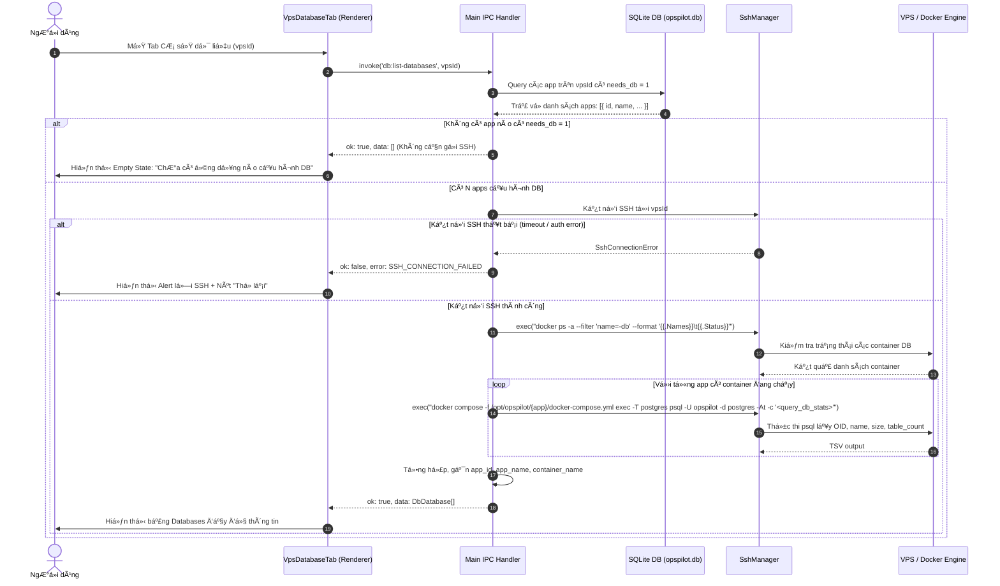

# Thiết Kế Kiến Trúc & Kế Hoạch Xá»­ Lý GAP AC-3.2: Quản Trị PostgreSQL Trên VPS (Checkpoint DB-0)

> **Mục tiêu tài liệu**: Báo cáo audit chuyên sâu và đề xuất giải pháp thiết kế kiến trúc toàn diện cho khiếm khuyết duy nhất còn lại sau đợt tái thiết kế UI (**GAP AC-3.2**: Tab Cơ sở dữ liệu trên trang Chi tiết VPS chưa hỗ trợ kết nối IPC backend).
> **Phạm vi Checkpoint DB-0**: Thuần túy audit mã nguồn và đề xuất thiết kế kiến trúc. **Không sửa đổi runtime, không thay đổi IPC contract và không tự ý đánh dấu AC-3.2 PASS**.

---

## 1. Hiện Trạng Audit & Phân Tích Nguyên Nhân Gốc Rễ

### 1.1. Đối chiếu các thành phần mã nguồn hiện hữu

Qua quá trình đối chiếu chéo giữa các tầng của ứng dụng:

1. **Giao diện người dùng (`app/src/renderer/src/components/VpsDatabaseTab.tsx`)**:
   - Đã được xây dựng giao diện hoàn chỉnh với 2 bảng dữ liệu chính (*Database Users* và *Databases*), modal tạo người dùng, modal tạo database, trình thiết kế schema đồ họa (`DbSchemaDesigner`), tính năng import/export file CSV/JSON và xem trước câu lệnh SQL DDL.
   - Nhận thuộc tính `supported?: boolean` với giá trị mặc định là `false` (`supported = false`).
   - Khi `!supported`, component hiển thị màn hình trống (`Empty`) với thông báo: *"Chưa hỗ trợ cơ sở dữ liệu - Tính năng quản lý cơ sở dữ liệu trên máy chủ hiện chưa khả dụng trong OpsPilot"*.
   - Khối gọi IPC nội bộ `callDb()` đã được bọc an toàn; nếu backend chưa xử lý kênh, UI sẽ nhận lỗi `UNKNOWN` trung thực thay vì giả lập thành công.

2. **Khung vỏ Chi tiết VPS (`app/src/renderer/src/components/VpsDetail.tsx`)**:
   - Tại Tab 3 (`key: 'database'`), component render `<VpsDatabaseTab vpsId={vps.id} />` nhưng **không truyền thuộc tính `supported`**, khiến `supported` luôn nhận giá trị mặc định là `false`.

3. **Hợp đồng IPC (`app/src/shared/ipc.ts`)**:
   - Đã khai báo đầy đủ các kiểu dữ liệu DTO (`DbDatabase`, `DbUser`, `DbUserInput`, `DbSchemaTable`, `DbSchemaColumn`, `DbSchemaForeignKey`, `DbImportInput`, `DbExportFile`, `DbQueryResult`).
   - Đã định nghĩa 9 kênh invoke trong `IpcInvokeMap`:
     - `db:list-databases`: `(vpsId: number) => IpcResult<DbDatabase[]>`
     - `db:create-database`: `(vpsId: number, name: string) => IpcResult<DbDatabase>`
     - `db:list-users`: `(vpsId: number) => IpcResult<DbUser[]>`
     - `db:create-user`: `(vpsId: number, input: DbUserInput) => IpcResult<DbUser>`
     - `db:list-tables`: `(vpsId: number, database: string) => IpcResult<DbSchemaTable[]>`
     - `db:save-schema`: `(vpsId: number, database: string, ddl: string) => IpcResult<void>`
     - `db:import-data`: `(vpsId: number, database: string, input: DbImportInput) => IpcResult<{ imported_tables: number; imported_rows: number }>`
     - `db:export-data`: `(vpsId: number, database: string, format: 'json' | 'csv' | 'sql') => IpcResult<DbExportFile>`
     - `db:query`: `(vpsId: number, database: string, sql: string) => IpcResult<DbQueryResult>`
   - *Ghi chú trong mã nguồn*: Kênh được thiết kế từ giai đoạn TK-B9 với giả định chạy lệnh dạng: `docker compose exec -T db psql -U opspilot -At -c "<sql>"`.

4. **Tiến trình chính Main (`app/src/main/ipc.ts`)**:
   - Trong hàm `registerIpcHandlers()`, **chưa đăng ký bất kỳ handler nào** cho các kênh có tiền tố `db:*`.

---

## 2. Kiến Trúc Thực Tế: PostgreSQL Trên VPS Trong OpsPilot

### 2.1. Cấu trúc triển khai: Isolated Per-App Container

Khác với giả định ban đầu về một container PostgreSQL dùng chung toàn VPS (`docker compose exec -T db`), kiến trúc triển khai thực tế của OpsPilot (được hiện thực hóa trong [`templates.ts`](../../app/src/main/deploy/templates.ts) và [`pipeline.ts`](../../app/src/main/deploy/pipeline.ts)) hoạt động theo nguyên lý **cô lập hoàn toàn theo từng ứng dụng (Per-App Container)**:

- Khi một ứng dụng được triển khai với `needs_db === 1`:
  - Mã nguồn và cấu hình được đặt tại thư mục riêng biệt trên VPS: `/opt/opspilot/${APP_NAME}/`.
  - Tệp `docker-compose.yml` định nghĩa một service `postgres` riêng biệt:
    - **Tên container**: `${APP_NAME}-db` (ví dụ: `express-api-db`, `next-blog-db`).
    - **Image**: `postgres:16-alpine`.
    - **Lưu trữ dữ liệu**: Volume cục bộ `./data/pg:/var/lib/postgresql/data` (nằm trong thư mục của chính app đó).
    - **Giới hạn tài nguyên**: `mem_limit: 256m`.
    - **Mạng nội bộ**: Port 5432 **không mở ra ngoài host** (không có `ports:` host mapping), chỉ giao tiếp nội bộ trong mạng Docker của ứng dụng.
    - **Thông tin đăng nhập mặc định**: User `opspilot`, Database `opspilot`, mật khẩu sinh ngẫu nhiên lưu trong `/opt/opspilot/${APP_NAME}/.env` (`POSTGRES_PASSWORD`).

### 2.2. Vấn đề cốt lõi khi một VPS có nhiều ứng dụng (Multi-app VPS)

Khi trên cùng một máy chủ VPS có nhiều ứng dụng cùng sử dụng cơ sở dữ liệu (ví dụ: cả `express-api` và `next-blog` đều có `needs_db = 1`):
1. **Xung đột định danh (Name Collision)**: Cả 2 container độc lập đều mặc định khởi tạo một database có tên là `opspilot`. Nếu chỉ trả về danh sách database phẳng dạng `[{ name: 'opspilot' }, { name: 'opspilot' }]`, người dùng không thể phân biệt được database nào thuộc về ứng dụng nào.
2. **Mất định tuyến trong thao tác chi tiết**: Khi người dùng bấm vào dòng database `opspilot` để xem danh sách bảng (`db:list-tables(vpsId, 'opspilot')`) hoặc lưu schema (`db:save-schema(vpsId, 'opspilot', ddl)`), backend không thể biết cần thực thi lệnh `psql` vào container nào (`express-api-db` hay `next-blog-db`).
3. **Các ứng dụng không cần DB**: Các ứng dụng như `static-spa` hoặc `nextjs` không bật `needs_db` sẽ không có container database nào chạy kèm.

---

## 3. Giải Pháp Định Danh Database Gắn Với App & Deployment

Để giải quyết triệt để bài toán đa ứng dụng mà vẫn giữ nguyên triết lý **App-Centric** của OpsPilot, thực thể cơ sở dữ liệu hiển thị trên VPS phải được gắn chặt với ứng dụng sở hữu:

### 3.1. Mô hình định danh thực thể (Database Entity Identity)

Mỗi cơ sở dữ liệu trên VPS được định danh duy nhất bởi bộ ba:
$$\text{DatabaseIdentity} = (\text{vps\_id}, \text{app\_id}, \text{db\_name})$$

Hoặc định danh tổng hợp (Composite Key):
$$\text{composite\_id} = \text{"\{app\_name\}:\{db\_name\}"}$$

### 3.2. Mở rộng kiểu dữ liệu DTO `DbDatabase`

Bổ sung ngữ cảnh ứng dụng sở hữu vào `DbDatabase` mà không phá vỡ tính tương thích ngược của các trường hiện hữu:

```typescript
export interface DbDatabase {
  /** OID của database trong PostgreSQL */
  oid: number;
  /** Tên database trong PostgreSQL (ví dụ: 'opspilot', 'blog_prod') */
  name: string;
  /** Dung lượng theo bytes */
  size_bytes: number;
  /** Số lượng bảng trong schema public */
  table_count: number;

  /* ── Các trường bổ sung phục vụ phân định ứng dụng (Checkpoint DB-1) ── */
  /** ID của app sở hữu container database này */
  app_id: number;
  /** Tên app sở hữu (ví dụ: 'express-api') */
  app_name: string;
  /** Tên container Docker đang chạy (ví dụ: 'express-api-db') */
  container_name: string;
  /** Trạng thái container: 'running' | 'stopped' | 'unhealthy' */
  status: 'running' | 'stopped' | 'unhealthy';
}
```

### 3.3. Trải nghiệm người dùng trên `VpsDatabaseTab`

1. **Bảng Cơ sở dữ liệu (Databases Table)**:
   - Bổ sung cột **Ứng dụng liên kết (`app_name`)**: Hiển thị thẻ tag gắn tên ứng dụng (kèm liên kết nhanh sang chi tiết ứng dụng nếu cần).
   - Bổ sung cột **Trạng thái container**: Tag màu xanh (`running`) hoặc vàng/đỏ (`stopped`).
   - Cung cấp **Dropdown lọc theo Ứng dụng (App Filter)** phía trên bảng: Cho phép lọc xem database của một ứng dụng cụ thể hoặc hiển thị toàn bộ máy chủ (`Tất cả ứng dụng`).
2. **Khóa định danh bảng Ant Design**:
   - Sử dụng `rowKey={(row) => `${row.app_id}-${row.name}`}` thay vì chỉ dùng `rowKey="name"` hoặc `rowKey="oid"`, triệt tiêu hoàn toàn lỗi trùng key trong React DOM.
3. **Mở chi tiết Database & Schema Designer**:
   - State mở database lưu cả `appId`: `openDbFor: { vpsId: number; appId: number; appName: string; name: string }`.

---

## 4. Luồng Dữ Liệu Đề Xuất (Proposed Data Flow)

### 4.1. Sơ đồ tuần tự: Liệt kê Database trên VPS



### 4.2. Câu lệnh SQL metadata trích xuất từ PostgreSQL

Khi gọi vào container PostgreSQL, lệnh truy vấn thông tin thống kê không khóa bảng và thực thi cực nhanh:

```sql
SELECT
  d.oid,
  d.datname,
  pg_database_size(d.datname) AS size_bytes,
  (SELECT count(*) FROM information_schema.tables WHERE table_schema = 'public') AS table_count
FROM pg_database d
WHERE d.datistemplate = false;
```

---

## 5. Thay Đổi IPC Contract Cần Thiết

Để hỗ trợ đầy đủ ngữ cảnh ứng dụng mà vẫn đảm bảo tính tương thích, hợp đồng IPC trong `app/src/shared/ipc.ts` được đề xuất điều chỉnh như sau:

| Kênh IPC | Chữ ký hiện tại | Chữ ký đề xuất | Mục đích & Khả năng tương thích ngược |
| :--- | :--- | :--- | :--- |
| `db:list-databases` | `(vpsId: number) => IpcResult<DbDatabase[]>` | Giữ nguyên chữ ký, **mở rộng dữ liệu trả về `DbDatabase`** (bổ sung `app_id`, `app_name`, `container_name`, `status`). | Tương thích ngược 100%. UI cũ chỉ đọc các trường cũ vẫn chạy bình thường. |
| `db:list-users` | `(vpsId: number) => IpcResult<DbUser[]>` | `(vpsId: number, appId?: number) => IpcResult<DbUser[]>` | Nếu truyền `appId`, liệt kê user của container app đó. Nếu không truyền, mặc định lấy app đầu tiên hoặc tổng hợp. |
| `db:list-tables` | `(vpsId: number, database: string) => IpcResult<DbSchemaTable[]>` | `(vpsId: number, database: string, appId?: number) => IpcResult<DbSchemaTable[]>` | Cho phép chỉ định chính xác container app chứa database cần xem schema. Nếu không truyền `appId`, tự suy diễn nếu trên VPS chỉ có 1 app DB. |
| `db:save-schema` | `(vpsId: number, database: string, ddl: string) => IpcResult<void>` | `(vpsId: number, database: string, ddl: string, appId?: number) => IpcResult<void>` | Định tuyến lệnh DDL vào đúng container của app. |
| `db:create-database` | `(vpsId: number, name: string) => IpcResult<DbDatabase>` | `(vpsId: number, name: string, appId?: number) => IpcResult<DbDatabase>` | Xác định container app tiếp nhận database mới. |
| `db:create-user` | `(vpsId: number, input: DbUserInput) => IpcResult<DbUser>` | `(vpsId: number, input: DbUserInput, appId?: number) => IpcResult<DbUser>` | Tạo user trong container app được chỉ định. |

---

## 6. Xử Lý Các Tình Huống Ngoại Lệ & Sự Cố Hạ Tầng

| Tình huống ngoại lệ | Hiện tượng kỹ thuật | Cơ chế xử lý đề xuất | Trải nghiệm người dùng (UX) |
| :--- | :--- | :--- | :--- |
| **VPS không có ứng dụng nào dùng PostgreSQL** | Bảng SQLite `app` không có bản ghi nào trên `vps_id` có `needs_db = 1`. | Handler phát hiện ngay từ bước kiểm tra DB nội bộ, lập tức trả về `ok: true, data: []` mà không thực hiện kết nối SSH. | Hiển thị màn hình `Empty` trung thực: *"Máy chủ chưa có ứng dụng nào cấu hình cơ sở dữ liệu. Các ứng dụng có tùy chọn cơ sở dữ liệu sẽ tự động khởi tạo PostgreSQL khi triển khai."* (Không báo lỗi). |
| **Có ứng dụng DB nhưng container chưa chạy / bị dừng** | Container `${app.name}-db` có trạng thái `Exited` hoặc không tồn tại trong `docker ps`. | Handler ghi nhận trạng thái `status: 'stopped'`, không gọi lệnh `psql` vào container đó để tránh treo tiến trình. | Dòng database vẫn xuất hiện trong bảng nhưng hiển thị trạng thái `Đã dừng` (tag màu cam/xám), vô hiệu hóa nút bấm xem schema kèm tooltip hướng dẫn khởi động lại app. |
| **Mất kết nối SSH / Sai thông tin xác thực** | `ssh.exec()` ném lỗi `SshConnectionError` hoặc `SshAuthError`. | Bắt lỗi tại tầng handler, bọc vào `IpcError` chuẩn với mã `SSH_CONNECTION_FAILED`. | UI hiển thị khối `Alert` màu đỏ mô tả rõ lỗi mạng/SSH kèm nút **"Thử lại"** (`Retry`), đồng nhất với cách xử lý lỗi tại tab Tài nguyên. |
| **PostgreSQL từ chối kết nối / Chưa khởi động xong** | Container đang chạy nhưng `pg_isready` trả về exit code khác 0. | Handler đặt timeout ngắn (3 giây) cho lệnh kiểm tra `pg_isready`; nếu chưa sẵn sàng, trả về mã lỗi `DB_NOT_READY`. | UI hiển thị thông báo: *"Dịch vụ PostgreSQL đang khởi động, vui lòng thử lại sau giây lát."* |

---

## 7. Phân Kỳ Kích Hoạt Thao Tác Ghi (Write Operations Phasing)

### 7.1. Đánh giá rủi ro an toàn dữ liệu

- **Thao tác chỉ đọc (Read-only)**: `list-databases`, `list-users`, `list-tables`.
  *Mức độ rủi ro: 0 (An toàn tuyệt đối)*. Các lệnh chỉ thực thi `SELECT` trên `pg_database` và `information_schema`, hoàn toàn idempotent, không thay đổi trạng thái hệ thống.
- **Thao tác ghi (Write operations)**: `create-database`, `create-user`, `save-schema`, `import-data`.
  *Mức độ rủi ro: Cao*.
  1. Việc tự ý tạo thêm database bên ngoài có thể không được ứng dụng (vốn kết nối cố định vào database `opspilot`) nhận diện.
  2. Lệnh `save-schema` thực thi DDL trực tiếp (`CREATE TABLE`, `DROP TABLE`, `ALTER TABLE`) có nguy cơ gây mất dữ liệu nghiêm trọng hoặc xung đột với cơ chế migration nội bộ của ứng dụng (Prisma, Drizzle, TypeORM, Knex).

### 7.2. Lộ trình phân kỳ kích hoạt

Nhằm đảm bảo nghiệm thu chắc chắn và fail-closed, các tính năng được phân kỳ như sau:

```
┌─────────────────────────────────────────────────────────────────────────────┐
│ Giai đoạn 1 (Checkpoint DB-1): Nghiệm thu Read-Only & Đóng GAP AC-3.2      │
├─────────────────────────────────────────────────────────────────────────────┤
│ • Bật supported={true} trong VpsDetail.tsx.                                 │
│ • Triển khai backend handlers CHỈ ĐỌC:                                      │
│   - db:list-databases (hỗ trợ phân biệt app)                                │
│   - db:list-users                                                           │
│   - db:list-tables                                                          │
│ • Vô hiệu hóa hoặc ẩn tạm thời các nút ghi (+ Tạo user, + Tạo DB, Lưu DDL). │
│ • Kết quả: AC-3.2 chính thức chuyển sang PASS với 0 rủi ro dữ liệu.         │
└─────────────────────────────────────┬───────────────────────────────────────┘
                                      │
                                      â–¼
┌─────────────────────────────────────────────────────────────────────────────┐
│ Giai đoạn 2 (Checkpoint DB-2): Kích hoạt Thao tác Ghi có bảo vệ             │
├─────────────────────────────────────────────────────────────────────────────┤
│ • Mở lại các nút: + Tạo Database, + Tạo Người dùng, Lưu Schema DDL.         │
│ • Bổ sung cơ chế bảo vệ an toàn:                                            │
│   - Modal cảnh báo xác nhận rủi ro trước khi thực thi DDL.                  │
│   - Transaction bọc ngoài (BEGIN ... COMMIT) cho save-schema.               │
│   - Kiểm tra trùng tên database / user trước khi tạo.                       │
│   - Không lưu mật khẩu bản rõ vào log hoặc đĩa.                             │
└─────────────────────────────────────────────────────────────────────────────┘
```

---

## 8. Kế Hoạch Triển Khai Từng Bước & Kiểm Thử Offline

Toàn bộ quy trình triển khai tuân thủ tuyệt đối quy tắc **không phụ thuộc VPS thật**, sử dụng cơ chế giả lập tầng SSH (Mock SSH Harness) tương tự như các bộ test đã hoàn thiện ở `headlessPoller.test.ts` và `service.test.ts`.

### 8.1. Các bước thực hiện chi tiết

1. **Bước 1: Xây dựng Module `DatabaseService` Backend (`app/src/main/db/databaseService.ts`)**
   - Đọc danh sách app từ `AppRepository`.
   - Kết nối `SshManager.exec()` để kiểm tra container và chạy lệnh `psql`.
   - Xử lý phân tích kết quả TSV thành đối tượng `DbDatabase[]`, `DbUser[]`, `DbSchemaTable[]`.
   - Xử lý fail-closed khi SSH lỗi hoặc container vắng mặt.

2. **Bước 2: Viết Bộ Kiểm Thử Độc Lập Offline (`databaseService.test.ts`)**
   - Tạo bộ mock SSH trả về stdout giả lập cho các kịch bản:
     - *Ca 1*: VPS không có app nào có `needs_db = 1` -> Trả về mảng rỗng ngay lập tức, không gọi SSH.
     - *Ca 2*: VPS có 1 app `express-api` với container `express-api-db` đang chạy -> Trả về database `opspilot` gắn đúng `app_id` và `app_name`.
     - *Ca 3*: VPS có 2 app `express-api` và `next-blog` cùng chạy DB -> Trả về 2 database riêng biệt có `app_name` khác nhau, không xung đột key.
     - *Ca 4*: Container DB ở trạng thái `Exited` -> Báo `status: 'stopped'`, không ném lỗi unhandled.
     - *Ca 5*: Lệnh SSH thất bại do mất kết nối -> Ném lỗi `AppError` chuẩn có mã lỗi rõ ràng.
     - *Ca 6*: Lấy danh sách bảng cho một database cụ thể -> Phân tích chính xác cột, kiểu dữ liệu, khóa chính và khóa ngoại.

3. **Bước 3: Đăng Ký Handler Trong `app/src/main/ipc.ts`**
   - Nối các kênh `db:list-databases`, `db:list-users`, `db:list-tables` vào `DatabaseService`.

4. **Bước 4: Cập Nhật UI `VpsDatabaseTab.tsx` & Bật `supported={true}` Trong `VpsDetail.tsx`**
   - Truyền `supported={true}` từ `VpsDetail.tsx`.
   - Bổ sung hiển thị `app_name` và bộ lọc app trong `VpsDatabaseTab.tsx`.
   - Viết test Vitest Renderer cho `VpsDatabaseTab.test.tsx` xác nhận bảng hiển thị đúng khi có dữ liệu mock từ IPC.

5. **Bước 5: Nghiệm Thu AC-3.2 & Cập Nhật Tài Liệu**
   - Chạy toàn bộ quality gates: lint sạch 100%, typecheck sạch 100%, full app test pass.
   - Cập nhật checklist trong `docs/ui-redesign/README.md` và `docs/ui-redesign/ui-1k-acceptance.md`: chuyển AC-3.2 từ **GAP** sang **PASS**.

---

## 9. Kết Luận Checkpoint DB-0

- Bản thiết kế trên đã xác định chính xác nguyên nhân gốc rễ và đặc thù kiến trúc per-app container của OpsPilot.
- Đã giải quyết trọn vẹn bài toán đa ứng dụng trên cùng một VPS thông qua mô hình định danh database có ngữ cảnh app (`app_id`, `app_name`).
- Đã thiết lập kế hoạch kiểm thử offline hoàn chỉnh, tách biệt rõ ràng giữa thao tác Đọc (an toàn) và thao tác Ghi (bảo vệ dữ liệu).
- Checkpoint DB-0 hoàn thành việc chuẩn bị tài liệu thiết kế; sẵn sàng bước vào Checkpoint DB-1 khi có chỉ thị triển khai mã nguồn.
